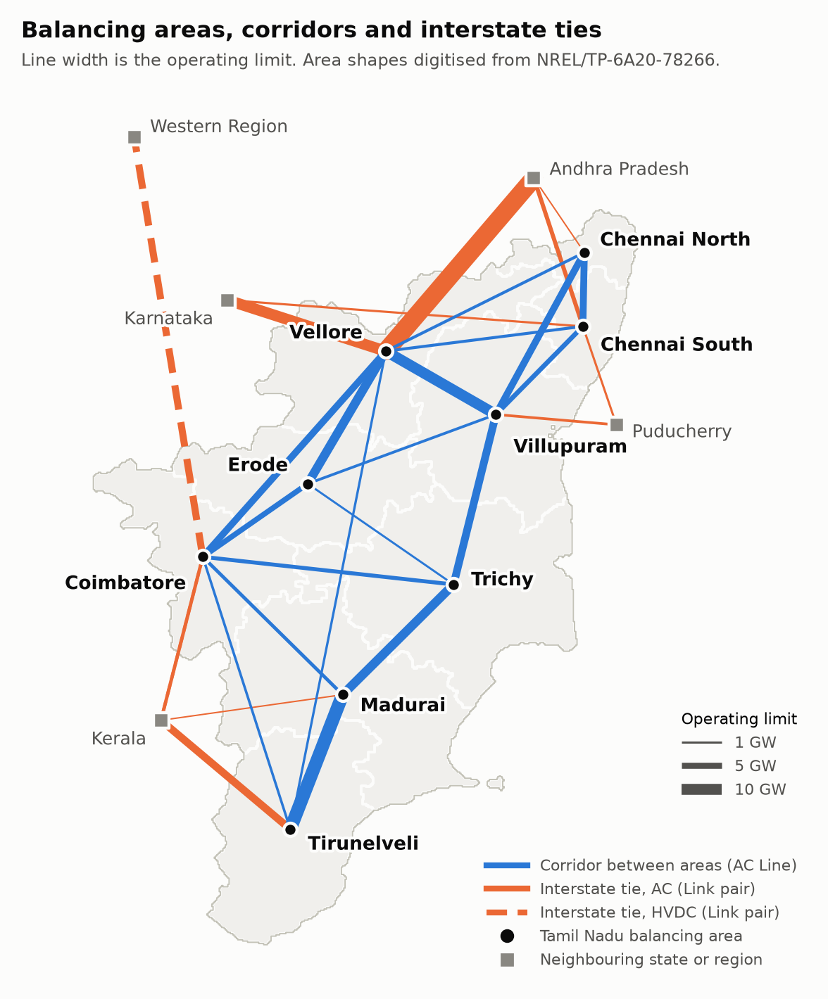

# Tamil Nadu nine-balancing-area model

This repository contains the hourly, nine-balancing-area PyPSA
unit-commitment model of Tamil Nadu's power system for FY2025-26. It is the
repository's only supported model. The ready-to-load PyPSA CSV folder is
`model/`. See [How to run](#how-to-run) for environment setup, rebuilding,
and run configuration. To load the network programmatically:

```python
import pypsa

network = pypsa.Network("model")
```



## Model at a glance

| | |
| --- | --- |
| Period | FY2025-26, 8,760 hours (1 April 2025 to 31 March 2026, IST) |
| Areas | 9 Tamil Nadu balancing areas, one bus each; 5 neighbouring buses (Andhra Pradesh, Karnataka, Kerala, Puducherry, Western Region) |
| Demand | 131.38 TWh; peak 19,987 MW on 11 July 2025 |
| Installed capacity | 48,224 MW (July 2026 vintage): coal and lignite 15,033, solar 14,046, wind 12,299, nuclear 2,440, hydro 2,219, bio-power 1,028, oil and gas 845, diesel 212, small hydro 103 |
| Unit commitment | The 49 coal and lignite units; all other plants are dispatched without commitment |
| Grid | 18 corridors between areas (84 GW of operating limits); 12 interstate ties (51.5 GW into Tamil Nadu); optional second voltage level per area |
| Imports and exports | Fixed hourly schedule from the SRPC accounts, matched to the metered net import (13.72 TWh); Grid-India's import limit; optional trading at IEX prices |
| Calibration | Observed oil-and-gas, nuclear, bio-power and small-hydro energy by default; solar availability calibrated to observed annual generation |
| Scenarios | Batteries and offshore wind, through a Snakemake workflow |

## Documentation

| Document | Contents |
| --- | --- |
| [Model description](docs/model-description.md) | Scope and structure, demand, one section per technology (coal and lignite, nuclear, oil and gas, diesel, bio-power, hydro, small hydro, solar, onshore wind, offshore wind, batteries), the grid with imports and exports, and the calibration to observed generation: the assumptions, their sources, the options and the tests |
| [Input data guide](docs/input-data.md) | Where each input is, its format and how it is prepared |
| [Solar availability methodology](docs/solar-availability-methodology.md) | How hourly solar availability is derived and validated |
| [`model/DATA_DOCUMENTATION.md`](model/DATA_DOCUMENTATION.md) | The files of the built network |
| [`results/README.md`](results/README.md) | Where runs write their outputs |
| `data/source/*/README.md` | Provenance and checks of each source dataset |

## Repository layout

| Path | Purpose |
|---|---|
| `model/` | Ready-to-load 8,760-hour PyPSA CSV network |
| `data/model_inputs/` | Spatial mappings, grid capacities, hydro registries, demand allocation, renewable profiles, costs and other prepared inputs |
| `data/build_template/` | Build-stage statewide time series and component tables; not a supported standalone model |
| `data/source/` | Source workbooks and supporting datasets |
| `data/reservoirs/` | Validated reservoir observations used by the hydro model |
| `scripts/` | Build, run, validation, analysis, and data-collection utilities |
| `config/` | YAML run configurations: `defaults.yaml`, one file per run in `runs/`, one file per scenario in `scenarios/`, technology parameters in `technologies.yaml`, CO2 factors in `emission_factors.yaml`, and the Snakemake settings in `workflow.yaml` |
| `Snakefile` | Scenario workflow: capacity expansion, operational run and comparison for every scenario |
| `docs/` | Model description, input data guide, solar methodology and figures |
| `notebooks/` | Interactive analysis workflows |
| `outputs/` | Reconstructed SRPC REA schedules and other prepared audit outputs |
| `results/` | Local generated outputs; ignored by Git except for its README |
| `tests/` | Automated tests (`python -m pytest`) |

## How to run

Run these commands from the repository root. The example uses PowerShell; on
macOS or Linux, activate the virtual environment with `source .venv/bin/activate`.
If `python` is not on your path, use the Python executable from your environment.

1. With Python 3.11 or newer, create an environment and install the packages
   used to build, solve, and analyze the model:

   ```powershell
   python -m venv .venv
   .venv\Scripts\Activate.ps1
   python -m pip install -r requirements.txt
   ```

2. Use the checked-in `model/` network, or rebuild it after changing inputs
   (about 10 seconds):

   ```powershell
   python scripts/build_9ba_model.py
   ```

   The interstate exchange matches Tamil Nadu's metered net import by default
   (`--interchange transactions` uses the REA transactions only); see
   [Metered interchange](docs/model-description.md#metered-interchange-default).

3. For a first solve, run the one-day example config. It solves 11 July 2025,
   the day of the annual demand peak, with relaxed unit commitment on one
   thread and finishes in under a minute:

   ```powershell
   python scripts/run_model.py config/runs/daily_demo.yaml
   ```

4. When the solve finishes, the runner builds a results report and prints its
   location. With the settings above, the run folder is
   `results/run_results/daily_2025-07-11_relaxed/daily_demo/`. Open
   `results_report.html` there. It is a single self-contained file, with
   figures embedded, that you can share. The folder also holds
   `validation.json`, the CSV comparisons, `solved_network.nc`, the
   standardized `analysis/` tables and figures, the `profile/` folder, and
   `run_config.yaml`, which records the exact settings used.

The loaded `model/` network carries no energy targets, so
`network.optimize(snapshots=network.snapshots[:24])` is feasible but is not
calibrated to observed generation. Use `scripts/run_model.py` for calibrated
runs: by default every mode applies the observed oil-and-gas and nuclear
targets for each solved day, and the bio-power and small-hydro targets over
the solved period (`scripts/period_energy_targets.py`; see
[Calibration](docs/model-description.md#calibration-to-observed-generation)).

### Run configuration

Runs are configured with YAML files. `config/defaults.yaml` holds every
setting with its default and a comment. A run config in `config/runs/` is
merged on top of it, so it only lists what differs. Unknown sections or keys
are rejected before the network is loaded, so a typo fails immediately.

| Config | Run |
| --- | --- |
| `config/runs/daily_demo.yaml` | One relaxed day on one thread; use it for a first run |
| `config/runs/rolling_relaxed.yaml` | Full-year rolling run, relaxed unit commitment |
| `config/runs/rolling_full_uc.yaml` | Full-year rolling run, binary unit commitment |
| `config/runs/selected_weeks_relaxed.yaml` | Four independent seasonal test weeks |
| `config/runs/annual_lp.yaml` | All 8,760 hours as one no-unit-commitment LP |
| `config/runs/annual_released.yaml` | Annual LP with the four energy targets released (nuclear must-run) |
| `config/runs/annual_capped_annual.yaml`, `annual_capped_monthly.yaml` | Annual LP with gas and bio-power as fuel-limited plants, annual or monthly energy caps |
| `config/runs/rolling_relaxed_cap_allocation.yaml`, `rolling_relaxed_cap_shadow_price.yaml` | Rolling year with the monthly caps passed on from `annual_capped_monthly` (run that first) |

For a new study, copy one of these files, give `run.name` a new value, and
change the settings you need. A rolling relaxed run config looks like this:

```yaml
run:
  name: relaxed_lp
  mode: rolling
  resume: true

formulation:
  unit_commitment: relaxed

rolling:
  time_limit: Default
  max_time_limit_mip_gap: 0.10
```

Useful command-line options:

```powershell
# Check the merged settings without solving
python scripts/run_model.py config/runs/rolling_relaxed.yaml --dry-run

# Override single settings without editing the file
python scripts/run_model.py config/runs/rolling_relaxed.yaml --set run.name=relaxed_test --set rolling.max_windows=2

# Solve only; skip the results analysis and report
python scripts/run_model.py config/runs/rolling_relaxed.yaml --no-analysis

# Turn detailed logging and profiling off (or on) for this run only
python scripts/run_model.py config/runs/rolling_relaxed.yaml --no-profile

# Repeat an earlier run exactly from its saved settings
python scripts/run_model.py results/run_results/daily_2025-07-11_relaxed/daily_demo/run_config.yaml

# Also write a short YAML summary (run folder, report, status), as the Snakemake workflow does
python scripts/run_model.py config/runs/daily_demo.yaml --summary daily_demo_summary.yaml
```

`run_model.py` exits with 0 on success, with 1 if the config is invalid or the
solve fails, and with 2 if the solve succeeded but the results analysis failed.
In that last case the run outputs are kept, and you can rebuild the report
later. Unless `logging.console_log` is `false`, Python console output is also
written to `results/run_results/console_logs/<run name>_<UTC time>.log`. HiGHS
writes its solver output directly to the terminal, so it is not in that file;
with `logging.profile: true` the complete HiGHS log of every solve is kept in
the run's `profile/highs/` folder instead.

| Setting | How to set it |
| --- | --- |
| `run.mode` | Choose `daily`, `monthly`, `peak`, `selected_weeks`, `annual`, or `rolling`. The modes and their output behavior are described [below](#run-modes-and-results). |
| `run.name` | Required. Give each study a distinct output folder name. It must start with a letter or number, have at most 80 characters, and contain only letters, numbers, `.`, `_`, or `-`. Reusing a name can reuse checkpoints or overwrite outputs in that folder. |
| `run.reference_date` | Use a date in `YYYY-MM-DD` format within 1 April 2025–31 March 2026. `daily` runs that date; `monthly` runs every day in its month. It is ignored for the other modes. |
| `run.resume` | `true` reuses compatible completed selected-week solves or rolling checkpoints; `false` solves them again. It has no effect on daily, monthly, peak, or annual runs. Use a new `run.name` when changing study assumptions. |
| `selected_weeks.week_starts` | For `selected_weeks` only, list one or more first days of seven-day test periods as `YYYY-MM-DD` dates. Periods must not overlap; the seven days plus warm-up and look-ahead must fit inside the model year. The dates need not be Mondays. |
| `selected_weeks.warmup_days`, `selected_weeks.lookahead_days` | For `selected_weeks` only, set non-negative whole numbers of extra days before and after each retained week. They affect the solve but are excluded from reported comparisons. The rolling mode always uses its own seven-day accepted window plus one look-ahead day. |
| `selected_weeks.reservoir_initial_soc_fraction` | For `selected_weeks` only, choose a value from 0 to 1 for initial reservoir state of charge where no observed or documented proxy level is available. The default is `0.5`; test sensitivity when the fallback matters. |
| `selected_weeks.soc_boundary_tolerance_pu` | For `selected_weeks` only, the band (share of energy capacity, default `0.05`) around monthly stored-energy targets at a week's boundaries, used when `model/hydro_monthly_stored_energy.csv` is present. |
| `formulation.unit_commitment` | `full` uses binary on/off decisions; `relaxed` uses continuous on/off fractions and is faster but approximate; `none` removes commitment decisions and minimum stable output from formerly committable generators. `annual` requires `none`. Result folders are categorised by this setting: `_UC` (`full`), `_relaxed`, or `_LP` (`none`). |
| `solver.name` | Use `highs`, the solver used by the repository's run workflows. The thread and MIP settings below configure HiGHS. |
| `solver.threads` | Leave as `Default` to use the runner's defaults: 8 for `full`, `relaxed` and an `annual` LP solved with `lp_method: ipm`, 3 for other `none` (LP) runs. Set an integer from 1 to 8 to override the default. `full` uses HiGHS MIP parallelism; `none` uses the parallel dual simplex when more than one thread is selected. `relaxed` uses HiGHS' interior-point solver with crossover, which is single-threaded and was about 4× faster than the parallel dual simplex on a relaxed week with the same optimum; its threads are used by the dual-simplex retry. |
| `solver.lp_method`, `solver.crossover` | For `annual` only. `lp_method: Default` solves the full-year LP (about 2 million rows after presolve) with the dual simplex; `ipm` selects HiGHS' interior-point method and `simplex` the simplex. On the battery capacity-expansion LP the interior point was far slower: about 28 minutes to build its starting basis and 21 minutes per iteration, more than 10 hours projected. `crossover: false` (with `ipm`) skips the final crossover to a basic solution: faster, with the same capacities and dispatch, and duals (prices) of interior-point accuracy. |
| `solver.simplex_strategy` | For `annual` and `rolling` only: an integer overriding HiGHS' `simplex_strategy`; `null` (the default) keeps the runner's choice. |
| `solver.parallel_workers` | Leave as `Default` to use 2 workers for independent daily, monthly, or selected-week solves. Set a positive integer to override it. Peak, annual, and rolling runs use one effective worker regardless of this setting. Active workers × effective solver threads cannot exceed the logical CPUs visible to Python. |
| `solver.mip_rel_gap` | Target relative optimality gap for `full` mixed-integer solves; `0.01` means 1%. It is ignored by `relaxed` and `none`. |
| `rolling.time_limit` | For `rolling` only. `Default` sets a per-attempt limit by unit commitment: 300 s for `none`, 700 s for `relaxed` (about 10× a normal coal-only relaxed week), 1,800 s for `full`. A positive number of seconds overrides it; `null` removes the limit. LP windows must still reach optimality. If a window fails, it is retried automatically: `relaxed` retries with the dual simplex; `none` and `full` retry with a different HiGHS random seed and then the serial solver. Each window's `solve_attempts` and `solve_attempt_log` record what happened. `null` disables retries, because a stalled solve never returns. It does not apply to `annual`. |
| `rolling.max_time_limit_mip_gap` | For a time-limited `rolling` run with `full` unit commitment, set the largest acceptable reported MIP gap from 0 to 1. `0.10` allows a window stopped at its time limit to be accepted only if its gap is at most 10%. This is separate from `solver.mip_rel_gap`. |
| `rolling.max_windows` | For testing only: stop a rolling run after this many windows. Leave as `null` for a full year. |
| `paths.network`, `paths.results_root` | Input network and output root. Relative paths are resolved from the repository root. |
| `logging.profile` | `true` (the default) turns on detailed run logging and profiling: the run writes the `profile/` folder described in [Run logging and profiling](#run-logging-and-profiling), including the complete HiGHS log of every solve. `false` runs without it. `--profile` / `--no-profile` on the command line override it. |
| `logging.level` | `INFO` (the default), `DEBUG`, `WARNING`, or `ERROR`. `DEBUG` adds the PyPSA and Linopy debug messages to `profile/run.log`. Used only when `logging.profile` is `true`. |
| `logging.sample_interval` | Seconds between resource samples in `profile/resources.csv`; default `1.0`. |
| `logging.console_log` | `true` (the default) copies Python console output to `results/run_results/console_logs/<run name>_<UTC time>.log`. |
| `analysis.enabled`, `analysis.compare_observed` | Build the results report after the run, and include comparisons with observed generation and capacity. Both default to `true`. |
| `energy_targets.*` | How the observed energy of oil and gas, nuclear, bio-power and small hydro is imposed: `target` (exact equalities, the default), `availability`, `must_run`, `energy_cap` or `free`, with the availability and cap settings. See [Releasing the energy targets](docs/model-description.md#releasing-the-energy-targets). |
| `marginal_costs.*` | Marginal-cost overrides (INR/MWh) for every unit of `oil_gas`, `diesel`, `bio_power`, `nuclear` or `small_hydro`, for sensitivity runs; `null` keeps the official costs. |
| `rooftop_solar.include` | `true` (the default) keeps grid-connected rooftop solar as supply, as built. `false` removes its nine area generators before the solve, because the demand series is already net of rooftop output. See [Rooftop solar](docs/model-description.md#rooftop-solar). |
| `outages.*` | Coal unit availability; off by default (`outages.enabled: false`, static coal `p_max_pu` 0.85). When on, the hourly availability of the 49 committable coal units follows auxiliary consumption, demonstrated capability, the FY2025-26 maintenance and forced-outage record (or optimised maintenance and sampled outages) and, for the seven central stations, their declared capacity. See [Coal availability](docs/model-description.md#availability-maintenance-and-outages). |
| `grid.*` | `grid.two_level: true` gives every Tamil Nadu area a 400 kV bus joined to its existing bus by the area's 400/230 and 400/110 kV transformers (N-1), splits corridors and ties by circuit voltage and moves 400/765 kV plants up; off by default. See [Two voltage levels](docs/model-description.md#two-voltage-levels-per-balancing-area-optional). |
| `interstate.*` | `interstate.drawal_limit`: `ttc` (the default) limits Tamil Nadu's drawal from the interstate grid in every hour to Grid-India's declared total transfer capability of the month, `atc` to the available transfer capability, `none` leaves only the per-tie ratings. See [Tamil Nadu import limit](docs/model-description.md#tamil-nadu-import-limit-grid-india). |
| `exchange_trading.*` | `exchange_trading.enabled: true` takes Tamil Nadu's observed power-exchange trades out of the fixed interstate schedule and lets the model buy and sell at the hourly IEX price of Tamil Nadu's bid area; off by default. See [Exchange trading](docs/model-description.md#exchange-trading-at-iex-prices-optional). |
| `ists_re_plants.*` | `ists_re_plants.enabled: true` runs the 13 interstate-connected wind and solar plants at Tuticorin, Karur and Pugalur on their FY2025-26 output and shrinks the area fleets by their capacity; `ists_re_plants.wind_seasonal: true` reshapes every other wind generator to the plants' monthly pattern. Both off by default. See [Interstate wind and solar plants](docs/model-description.md#interstate-wind-and-solar-plants-on-their-real-output-optional). |
| `technologies.*` | Batteries and offshore wind added for a scenario; empty by default, so runs use the model as it is. See [Scenarios](#scenarios-batteries-and-offshore-wind). |

### Run modes and results

| Mode | Period solved | State between periods |
| --- | --- | --- |
| `daily` | The 24 hours of `run.reference_date` | One independent day. |
| `monthly` | Each day in the month of `run.reference_date`, solved separately | Commitment and storage state do not carry between days. |
| `peak` | The continuous Monday–Sunday week containing the annual maximum hourly demand | One 168-hour solve. |
| `selected_weeks` | Each seven-day period in `selected_weeks.week_starts`, with configured warm-up and look-ahead | Each period is independent; observed reservoir levels constrain its boundaries. |
| `annual` | All 8,760 hours in one continuous no-unit-commitment LP | No rolling boundaries or look-ahead. Daily and build-defined weekly operating targets remain constraints inside the one model. Requires `formulation.unit_commitment: none`. |
| `rolling` | All 8,760 hours in consecutive windows; seven days accepted and one day used for look-ahead | Commitment, dispatch history, and storage state carry between windows. |

Every mode applies the energy targets of the run config and writes
comparison tables, validation, and a plot. Daily and peak runs also save a
solved network in their run folder; selected weeks save one network per week,
and rolling runs save retained checkpoints. Annual and short continuous runs
save one solved network. Output goes under
`results/run_results/<mode_label>/<run_name>/`. The mode label may include a
date or period and ends with the unit-commitment category: `_UC` for `full`,
`_relaxed` for `relaxed`, and `_LP` for `none`.
`run_model.py` prints the exact path after each run. Coal unit outages
(planned maintenance and forced outages) apply only with `outages.enabled:
true`; no mode introduces other equipment faults.

**Rolling runs.** Each optimization covers eight days: the first seven are
accepted and exported, while the eighth supplies look-ahead and is
re-optimized in the next window. Generator dispatch and consecutive on/off
history, plus storage state of charge, are passed across weekly boundaries;
the first window starts with the coal units online
([Initial commitment state](docs/model-description.md#initial-commitment-state)).
With `formulation.unit_commitment: relaxed`, the runner carries fractional
status, dispatch, and recent fractional start/shut-down history across weekly
boundaries. Completed windows are checkpointed under the run folder's
`weekly_networks/` (for `config/runs/rolling_relaxed.yaml`,
`results/run_results/rolling_2025-04-01_2026-03-31_relaxed/rolling_relaxed/weekly_networks/`);
keep `run.resume: true` to continue an interrupted run. The final one-day
window has no look-ahead because it reaches the end of the available input
horizon. The full-year relaxed run takes about an hour.

`window_log.partial.csv` is updated after each completed window and
`window_log.csv` is written at the end. Each row includes wall time for model
construction and solving, process CPU seconds, average CPU cores used (CPU
seconds divided by wall seconds), and sampled peak process memory and thread
count. Peak values are sampled every 0.5 seconds, so short spikes may be
missed. The thread count covers the whole Python process and may include
library threads in addition to HiGHS threads. The same metrics are stored in
each window's checkpoint JSON. Resumed checkpoints created before these
metrics were added will have empty values for the new columns.

**Selected weeks.** Every date in `selected_weeks.week_starts` is the first
day of an independent seven-day test period. Each optimization also includes
`warmup_days` before the retained week and `lookahead_days` after it. Only the
seven test days enter the reported comparison. The complete solved network,
daily tables, validation, and plot for each week are written to
`week_YYYY-MM-DD/` in the run folder, for example
`results/run_results/selected_weeks_UC/<run_name>/week_2025-04-07/` for full
unit commitment; combined outputs and `selected_week_log.csv` are in the
`<run_name>/` folder. With `run.resume: true`, a completed week is reused when
its model version, solver, MIP gap, warm-up, look-ahead, and reservoir
initial-SOC settings match the current run. Reservoir state does not transfer
across gaps between selected weeks; each solve uses observed storage at its
boundaries ([Hydro](docs/model-description.md#storage-across-solves)). A full
rolling run is still required when the study question needs endogenous
chronological carry-over rather than observed boundary conditions.

Resumed rolling windows and selected weeks are reused only if they were
solved with the same input network, checked with a content fingerprint of the
network including any scenario technologies. Checkpoints written before this
check existed are solved again once.

### Run logging and profiling

With `logging.profile: true` (the default), every run writes a `profile/`
folder inside its output directory. It records the solver logs and where
wall-clock time, CPU time, and memory go, so run-time improvements can be
targeted and measured. The runner prints a short summary at the end of the
run, and the results report includes it. To run without it:

```powershell
python scripts/run_model.py config/runs/rolling_relaxed.yaml --no-profile
```

| File | Contents |
| --- | --- |
| `run.log` | Timestamped runner, PyPSA, and Linopy messages, and one line for every phase longer than 1 s |
| `events.jsonl` | One record per phase (for example `run_rolling/window/optimize/build_model`): wall and CPU seconds, average cores, memory at the end, sampled peak memory, and the window, week, day, or solve attempt |
| `solves.jsonl`, `solves.csv` | One row per solver attempt. The time is split into PyPSA model build, custom constraints, LP-file write, HiGHS model read, HiGHS solve, remaining Linopy transfer, and solution and dual assignment. Each row also has the model size before and after presolve, the largest constraint groups, iteration counts, and MIP statistics (nodes, gap, time to the first incumbent, LP iterations by source) |
| `highs/*.log` | The complete HiGHS log of every attempt |
| `resources.csv` | Resource timeline, by default every second: process memory, CPU cores in use, threads, system CPU, available memory, and the active phase |
| `environment.json`, `run_status.json` | Package versions, hardware, Git revision, and run settings; final status, any error, totals, and peak memory |
| `summary.txt`, `summary.json` | Phase totals and shares of the run, the solve-time breakdown, and the slowest solves |

Rolling runs also add the accepted attempt's breakdown to each window's
`profile_*` columns in `window_log.csv`. A failed or interrupted run still
writes its profile. A repeated run keeps the earlier profile in
`profile_history/`. To rebuild one summary, or to compare runs side by side:

```powershell
python scripts/summarize_run_profile.py results/run_results/<label>/<run_name>
python scripts/summarize_run_profile.py <run A folder> <run B folder>
```

### Results analysis and report

At the end of a run, `run_model.py` calls `scripts/build_results_report.py`.
That script:

1. runs the standardized `scripts/results_analysis/` pipeline on every solved
   network the run kept (`solved_network.nc`, rolling `weekly_networks/`
   checkpoints, or one network per selected week), and writes its tables and
   figures to `analysis/` next to them;
2. writes `results_report.html` in the run folder. The report contains status
   tiles (solver status, rolling progress, unserved energy, demand, solver
   time), generation and installed capacity compared with observed values, the
   daily comparison plot, rolling solve performance from `window_log.csv`, the
   detailed analysis grouped by topic (system, monthly generation versus
   observed, coal fleet, grid, peak and stress weeks, storage, prices and
   costs, checks), the full `validation.json`, and the resolved run
   configuration.

The analysis is calculated with PyPSA's `n.statistics` at the electricity
buses, so the water-energy layer (reservoir stores, natural inflows, spill)
counts only where it reaches the grid through the hydro turbines. The report's
figures are drawn from these statistics, with daily means for long periods.

A rolling run is stored as one network per committed week. The analysis
stitches them into one network covering the whole run
(`scripts/results_analysis/stitching.py`): static data come from the first
week, which also holds the run's initial conditions, and every time series is
joined in time. Each week's start and initial storage are kept in
`network.meta["stitched"]` for the rolling-boundary audit; the per-week
objective values and energy-target constraints are dropped, so the stitched
network is for analysis only, not for solving. It is saved as
`stitched_network.nc` in the run folder and reused while the weekly files are
unchanged (checked by name, size and modification time), so later analyses
load one file instead of every week. To work with the whole year directly:

```python
from results_analysis import load_analysis_run

run = load_analysis_run("results/run_results/rolling_2025-04-01_2026-03-31_relaxed/rolling_relaxed")
n = run.network  # 8,760 snapshots
n.statistics.supply(bus_carrier="AC", nice_names=False)
n.statistics.supply.plot.bar(bus_carrier="AC")  # PyPSA's own plots work too
```

The loader gives the carriers the report's names and colours (in memory
only), which PyPSA's plots need.

| Output | Definition |
| --- | --- |
| Generation by carrier | `supply` from generators, storage discharge and the grid side of hydro turbines |
| Installed capacity | `installed_capacity`; turbines at their grid-side rating. The comparison's `total` and model shares exclude the unserved-energy slack generators |
| Balancing areas | Each bus's `energy_balance` split into generation, storage, net imports (Lines and AC/DC Links, with losses) and demand; the residual is zero |
| Corridors | `transmission` on every Line and AC/DC Link. An interconnector's two one-way links (`… →` and `… ←`) are one corridor; loading is the flow relative to the operating limit in the flow's direction (`s_nom * s_max_pu`, or that direction's `p_nom * p_max_pu`), so 100% means the limit binds |
| Grid utilisation (figures) | A map of the corridors coloured by mean loading and sized by limit, drawn with PyPSA's `n.plot.map` (one connection per link pair, with hours at the limit); histograms of each corridor's hourly loading, split by flow direction, for the AC lines between balancing areas and for the interconnectors |
| Wind and solar curtailment | `curtailment` and `supply` of the variable renewables: available, generated and curtailed energy and the curtailed share, by month and carrier and over the run; the figure adds the curtailed share by month and hour of day |
| Net-load duration and adequacy | Hours sorted by net load (demand net of the scheduled imports, minus wind and solar), against firm available capacity: every other generator's dispatch plus its `curtailment` (so after outages), with hydro at its full grid-side rating. Tables in 1% groups of hours with the mean and smallest margin; the figure shows what covered net load, over all hours and the 200 highest one by one |
| Price setters | In each hour and Tamil Nadu area, the flexible unit (part-loaded, or partly committed under relaxed commitment) whose marginal cost is nearest the price at its own bus, among buses within 3% of the area's price (losses, not congestion). Within 0.2% is an exact match, up to 10% the gap is start-up and commitment cost; hydro turbines and pumps count at their reservoir's water value. Other hours are scarcity (unserved-energy price), zero-price surplus, or set by an inter-temporal or energy constraint. Shares are weighted by demand, by month, hour of day and over the run; empty without prices |
| CO2 | Generation by carrier times the indicative factors in `config/emission_factors.yaml` (coal gross of auxiliary consumption), plus net imports into the Tamil Nadu areas at the grid factor; by month, with the intensity of generation and of Tamil Nadu's demand |
| Coal fleet | Per unit: dispatch from `supply`, available capacity as dispatch plus `curtailment` (so after outages and derating), online capacity as available capacity times `status`, minimum stable output as `status * p_min_pu * p_nom`. Per station: capacity factor, availability, online share, loading when online, share of online hours at minimum, start-ups, and with prices its market value and margin over marginal cost; also by month. The fixed `rea_export_reservation__*` generators (other states' shares of central stations) are reported apart from the units the model dispatches |
| Coal fleet (figures) | Daily dispatch against minimum, online, available and installed capacity, with daily start-ups; dispatch by hour of day and day as a share of available capacity; each station's capacity-hours split into generated, online but unused, available but offline, and unavailable, in merit order; unit loading when online and hourly ramps of the coal fleet against net load |
| Peak and stress weeks | Criteria pick one hour each: peak demand, peak and minimum net load (demand minus wind and solar), least spare thermal capacity (thermal `curtailment`: available but not dispatched), most unserved energy in a day, highest system price. The week from three days before each hour is analysed, and weeks that overlap by four days or more are merged. Tables give each week's system indicators and the supply in each criterion's hour; one figure per week shows hourly supply, the coal fleet, spare thermal capacity and price. Runs shorter than 14 days get the hours only |
| Storage | Per StorageUnit and finite Store (reservoir), and per asset class: discharge and charge from `supply` and `withdrawal`, inflow and spill, equivalent full cycles, discharge capacity factor, levels (start, end, minimum, mean, maximum, as % of energy capacity) and hours full or empty; over the run and by month |
| Operating costs | `opex` by carrier and cost type (marginal, start-up, shut-down, …) in million INR; `transmission` is the interstate-link charge. Model penalties are listed last and totalled separately from operating cost: unserved energy, `water_balance_adjustment` (the slack that makes reservoirs match measured storage) and the spill tie-break |
| Marginal prices | `prices` per bus: time- and load-weighted means, percentiles, and hours at the unserved-energy price |
| Market values | Revenue from supplied energy (`revenue`, output direction) divided by supplied energy, and its ratio to the load-weighted average price; slack generators are left out |
| System supply and demand (figure) | `energy_balance` summed over buses: supply stacked by carrier, with demand as a line; the gap between them is storage charging, pumping and transmission losses. Daily means for periods over a month |

Marginal prices come from the solver's duals. Relaxed and LP runs have them
directly; with relaxed commitment they reflect the continuous on/off
approximation.

Binary unit commitment (`full`) is a MIP, which has no duals. After each
accepted MIP solve, the runners (rolling windows, selected weeks, the peak week
and single days) solve the dispatch again as an LP, with every on/off,
start-up and shut-down decision fixed at its MIP value
(`scripts/commitment_prices.py`). The prices are that LP's duals, and its
dispatch replaces the MIP's: same commitment, at most the same cost.

- Each hour's price is the cost of one more MWh from the units that are online
  and not at a limit.
- Start-up costs are already fixed, so they never set the price.
- A unit held at minimum stable output does not set it either. When the online
  units sit at their minimum, the price falls to whatever is still flexible
  (curtailment, storage, the transmission flow cost), and can be negative.

A rolling window whose fixed-commitment LP fails (dual simplex, then interior
point) keeps the MIP dispatch, has no prices and is logged with a warning. Full
unit-commitment checkpoints without prices (made before this) are solved again
on resume. Full unit-commitment runs made before prices were added have empty
price tables, market values and price figures, and the system metrics mark the
average price as not available.

Monthly runs keep no solved networks, so their report covers the runner's own
outputs only. To rebuild a report for any existing run folder, for example
after an interrupted rolling run:

```powershell
python scripts/build_results_report.py results/run_results/rolling_2025-04-01_2026-03-31_relaxed/rolling_relaxed
```

Add `--runner-outputs-only` to skip loading the solved networks (fast), or
`--no-observed` to leave out observed-data comparisons.

## Scenarios: batteries and offshore wind

Scenarios add technologies to the model and are run with
[Snakemake](https://snakemake.readthedocs.io/). Each scenario is one config file
in `config/scenarios/`; add a scenario by adding a file there.

| File | Scenario |
| --- | --- |
| `baseline.yaml` | The model as it is |
| `battery.yaml` | Baseline plus 2-hour lithium-ion batteries, capacity optimised in all nine balancing areas |
| `offshore_wind.yaml` | Baseline plus offshore wind (IEA 15 MW turbines) in Tirunelveli |
| `battery_offshore_wind.yaml` | Baseline plus both |

A scenario config is a run config (any section of `config/defaults.yaml`)
plus a `technologies` section. All four use the same operational settings as
`config/runs/rolling_relaxed.yaml`, so their results compare like for like.
The offshore-wind capacity settings are examples to replace with the
project data. Each site's capacity is either fixed or optimised:

```yaml
technologies:
  battery:                       # site name -> settings; bus defaults to the site name
    Chennai North:
      capacity_mw: 500           # installed capacity, MW
    Tirunelveli:
      capacity_mw: optimise      # chosen by the model
      min_mw: 0                  # optional bounds
      max_mw: 2000
  offshore_wind:
    block2:
      bus: Tirunelveli           # the only balancing area offshore wind can connect to
      profile: block2            # column of the profile file; defaults to the site name
      capacity_mw: 1020          # fixed scenario choice, whole 15 MW turbines (68 here)
  totals:                        # optional: total optimised MW per technology
    battery: {max_mw: 1500}      # min_mw = max_mw sets an exact target, placed optimally
  parameters:                    # optional: this scenario's changes to config/technologies.yaml
    battery: {max_hours: 2}
```

Technology parameters are in `config/technologies.yaml`: battery duration
(`max_hours`), charging and discharging efficiencies, standing loss, costs,
and for offshore wind the turbine, the balancing areas it may connect to
(`allowed_buses`) and the profile file (hourly availability per MW for every
model hour, in Indian Standard Time, one column per profile). Values still to
be provided are `null`; a run that adds a technology with a required value
missing stops before solving and names the missing values. `capital_cost` is
the annualised cost per MW per year in INR and is required only to optimise a
capacity. Offshore wind capacity is an exogenous scenario choice
(`optimisable: false`): each scenario sets it in whole 15 MW turbines, and
`optimise` is rejected. Battery capacity is optimised by the model. The
assumptions behind the parameters (2-hour LFP batteries at INR 2.3 lakh per MW
per month; offshore wind at INR 41.8 million per MW per year and its
capacity factors) are in the model description:
[Battery storage](docs/model-description.md#battery-storage-scenario) and
[Offshore wind](docs/model-description.md#offshore-wind-scenario).

Run the scenarios:

```powershell
snakemake --cores 8                                       # every scenario
snakemake --cores 8 --config scenarios=[baseline,battery] # a selection
snakemake --cores 8 -n                                    # list what would run
snakemake --cores 8 --config 'overrides=["rolling.max_windows=2"]'   # quick test
```

For each scenario the workflow:

0. **Maintenance schedule** (only with `outages.planned: optimise`): PyPSA
   chooses the coal units' maintenance dates once, on the base network without
   the scenario's technologies, and saves them to
   `results/scenarios/<scenario>/maintenance_schedule.csv`; both runs below use
   it, so scenarios with the same outage settings share the same dates.
1. **Capacity expansion** (only if a site is `optimise`): solves the full year
   as one LP without unit commitment (`run.mode: annual`), with the optimised
   capacities as decision variables, and saves the chosen capacities to
   `results/scenarios/<scenario>/optimised_capacities.csv`. Rolling, monthly and
   selected-week runs solve periods separately and could not choose one
   capacity for the year, so capacities are sized in this one continuous LP.
2. **Operation**: runs the scenario's own settings (here the rolling year with
   relaxed unit commitment) with those capacities fixed
   (`technologies.fixed_capacities`). Results and the report are in
   `results/scenarios/<scenario>/<mode label>/operation/`.
3. **Comparison**: writes headline tables of all scenarios side by side to
   `results/scenarios/comparison/`: system metrics, generation and capacity by
   carrier, operating costs, and the capacities each scenario added.
4. **Effects**: for every scenario other than the baseline (when the baseline
   runs too), quantifies what its added technologies change, in
   `results/scenarios/effects/<scenario>/effects_report.html` with the tables as
   CSV. For offshore wind: available, generated and curtailed energy, capacity
   factor, market value and capture ratio; what each MWh of offshore wind
   replaces (by carrier, in net imports into Tamil Nadu, and in onshore
   curtailment); the operating-cost saving against the offshore annualised
   cost, net benefit and break-even cost; avoided CO2 and abatement cost; and
   the loading of the corridors at the offshore connection. CO2 uses the
   indicative factors in `config/emission_factors.yaml` (the model's carriers
   carry none). For batteries: power and energy capacity, charged and
   discharged energy, losses and cycles; the prices at which they charge and
   discharge and the arbitrage revenue, per balancing area too; what each MWh
   discharged changes; the operating-cost saving against the annualised cost,
   net benefit and break-even cost; avoided CO2; the change in system price,
   peak prices and the daily price spread; and an average day of charging,
   discharging and prices. When a scenario adds both, a combined table sets
   the joint savings against the joint cost, and each technology section
   reports the joint change, which cannot be split between them. Run it for
   any two runs with
   `python scripts/workflow/scenario_effects.py <baseline summary> <scenario summary> <output folder>`.

Each run records where it wrote its results in
`results/scenarios/<scenario>/<capacity_expansion|operation>.yaml`. Snakemake
reruns a scenario when its config, `config/defaults.yaml`,
`config/technologies.yaml`, the profile file, the outage inputs (when
`outages.enabled`) or the `model/` network changes.
Workflow settings, including extra run settings for every scenario, are in
`config/workflow.yaml`.

A scenario config also runs without Snakemake. A scenario with only fixed
capacities runs directly; one with optimised sites needs the capacity
expansion first:

```powershell
python scripts/run_model.py config/scenarios/battery.yaml --set run.mode=annual --set formulation.unit_commitment=none --set run.name=battery_capacity --summary capacity.yaml
python scripts/workflow/extract_capacities.py capacity.yaml battery_capacities.csv
python scripts/run_model.py config/scenarios/battery.yaml --set technologies.fixed_capacities=battery_capacities.csv
```

## Notebooks and other runners

**Peak week.** The peak-week notebooks are kept in `notebooks/`:

- `notebooks/9BA_run_peakday_2025_26.ipynb` selects the Monday–Sunday week
  containing the annual statewide demand peak, runs HiGHS unit commitment,
  validates nodal balances and corridor limits, and writes
  `results/tamil_nadu_9ba_2025_26.nc`. The exploratory mixed-integer solve uses
  a 1% relative MIP-gap tolerance; this keeps runtime proportionate after
  adding exact daily oil-and-gas energy targets, while remaining proportionate
  to the input-data uncertainty and retaining a near-optimal commitment
  schedule.
- `notebooks/analyze_peak_week.ipynb` reads that solved network through the
  shared result-analysis package and analyzes system dispatch, storage,
  commitment, balancing-area supply and demand, net imports, corridor flow and
  congestion, installed district capacity in absolute MW and as a statewide
  share, area renewable generation, and hourly ramp adequacy.

Run the peak-week notebook before the analysis notebook. Start Jupyter from
the repository root so both notebooks resolve the same paths. Neither
notebook creates equipment faults, forced outages, or contingency scenarios.
If peak mode was run with `scripts/run_model.py` instead, its run folder, for
example `results/run_results/peak_2025-07-07_UC/baseline/` when
`formulation.unit_commitment: full` and `run.name: baseline`, already has a
results report and can be passed to either analysis script.

**Rolling year.** After a rolling run is complete, its `results_report.html`
gives the standard summary. For interactive exploration, open
`notebooks/analyze_rolling_year.ipynb` and run all cells. It checks the
8,760-hour retained chronology and state handoffs, compares monthly and annual
modeled generation with the observed FY2025-26 workbook, reports full-load
hours, and shows unit commitment, storage, corridor loading and the coal
fleet's operation. The peak-week and rolling-year notebooks use the same
calculations, carrier taxonomy, plot styling, and output schema from
`scripts/results_analysis/`. Tables and figures are saved under each run's
`analysis/tables/` and `analysis/figures/` directories;
`analysis_manifest.json` records the source networks, horizon,
unit-commitment formulation, schema version, and Git commit. The same analysis
can be run without Jupyter:

```powershell
python scripts/analyze_results.py results/tamil_nadu_9ba_2025_26.nc
```

**Weekly peak days.** For a wider seasonal check, run:

```powershell
python scripts/run_9ba_weekly_days_2025_26.py
```

This selects the highest-energy-demand day from each Monday-Sunday week,
including the partial weeks at the FY boundaries, and solves all 53 days as
independent 24-hour unit-commitment problems. It compares modeled daily coal,
oil and gas, nuclear, hydro, solar, wind, and like-for-like total generation
with `data/source/TamilNadu_FY2025-2026_Electricity_Power_Generation_daily.xlsx`.
Each independent solve replaces the full-year oil-and-gas target with that
date's observed daily energy target. The workbook's Other RES series is
blank, so modeled bio-power and small hydro are reported without an
observed-error statistic. Tables and figures are written to
`results/weekly_days/`. The runner does not introduce equipment faults or
outages.

**July month.** `python scripts/run_9ba_month.py` solves all 31 days of July
2025 as independent 24-hour unit-commitment problems, covering all 744 July
hours at a 1% MIP tolerance. It enforces each day's gas, nuclear, bio-power
and small-hydro equality targets and writes validation results, daily and
monthly comparison tables, and a comparison plot under
`results/monthly/2025_07/`. A continuous 744-hour formulation was also
attempted, but its approximately 370,000 binary variables produced no feasible
integer schedule after about 112 minutes. The daily formulation does not carry
commitment or storage state between dates; each storage unit is cyclic within
its day. It is suitable for monthly generation and renewable-profile
comparison, rather than month-long chronological commitment or storage
analysis.

**Comparing runs.** `scripts/compare_energy_target_runs.py` compares solved
runs by month against observed generation, and `scripts/plot_price_comparison.py`
compares a run's Tamil Nadu price with the IEX day-ahead price.
`python scripts/plot_network_map.py` redraws the map at the top of this file
from `model/`.

## Generated files and Git

Generated files under `results/` are reproducible output and ignored by Git:
solved NetCDF networks, rolling checkpoints, CSV summaries, validation
JSON, plots, solver logs, and infeasibility files. Notebook cell outputs are
also cleared before commit. Keep durable, shareable study outputs in a release
or an external data archive rather than force-adding them to the repository.
`results/README.md` is the tracked exception.
