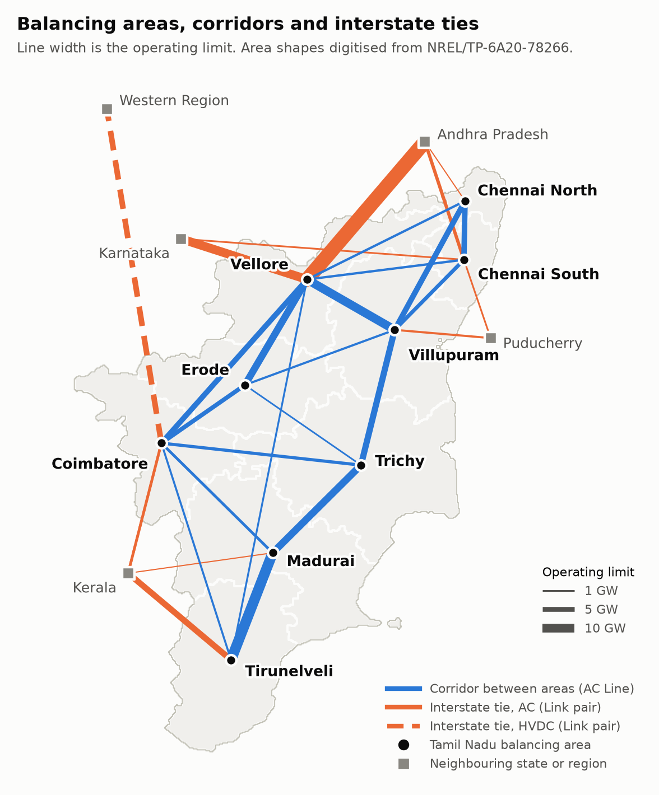

# Model description

This document describes what the nine-balancing-area model of Tamil Nadu
represents and the assumptions behind it: its scope and structure, demand, one
section per technology, the grid with the state's imports and exports, and the
calibration to observed FY2025-26 generation. How to build and run the model is
in the [README](../README.md). The [input data guide](input-data.md) lists every
input file with its format, provenance and preparation script, and the
[solar availability methodology](solar-availability-methodology.md) gives the
solar method in full.

Conventions: power in MW, energy in MWh or GWh (1 MU = 1 GWh), costs in Indian
rupees (INR; 1 lakh = 100,000). Model hours are hour-beginning Indian Standard
Time (IST). *Observed* means FY2025-26 data. *The build* is
`python scripts/build_9ba_model.py`, which writes the network in `model/`. A
*run-time option* is a setting in the run configuration (`config/defaults.yaml`)
that `scripts/run_model.py` applies to a copy of that network before solving;
`model/` itself is unchanged.

## Contents

- [Scope and structure](#scope-and-structure)
- [Demand](#demand)
- Technologies: [Coal and lignite](#coal-and-lignite) ·
  [Nuclear](#nuclear) · [Oil and gas](#oil-and-gas) · [Diesel](#diesel) ·
  [Bio-power](#bio-power) · [Hydro](#hydro) · [Small hydro](#small-hydro) ·
  [Solar](#solar) · [Onshore wind](#onshore-wind) ·
  [Offshore wind (scenario)](#offshore-wind-scenario) ·
  [Battery storage (scenario)](#battery-storage-scenario)
- [Grid, imports and exports](#grid-imports-and-exports)
- [Calibration to observed generation](#calibration-to-observed-generation)
- [Main limitations](#main-limitations)

## Scope and structure



*The nine balancing areas, the 18 corridors between them and the 12
interstate ties, drawn from `model/` by `scripts/plot_network_map.py`.*

### Time

The model covers FY2025-26 at hourly resolution: 8,760 snapshots from
1 April 2025 00:00 through 31 March 2026 23:00. Demand, wind and solar
availability, hydro inflows, the interstate schedule and the observed energy
targets are all FY2025-26 series. Installed capacity is the July 2026 vintage
(see [Installed capacity](#installed-capacity)).

### Balancing areas

Tamil Nadu is split into nine balancing areas, each one electrical bus.
`data/model_inputs/Balancing_areas.txt` maps the 38 districts to the areas.

| Area | Districts | Area (km²) | Demand (TWh) | Share | Peak (MW) | Installed (MW) |
|---|---|---:|---:|---:|---:|---:|
| Chennai North | Chennai, Tiruvallur | 3,570 | 11.13 | 8.5% | 1,696 | 5,142 |
| Chennai South | Chengalpattu, Kancheepuram | 4,670 | 13.93 | 10.6% | 2,100 | 733 |
| Coimbatore | The Nilgiris, Coimbatore, Tiruppur | 12,230 | 20.16 | 15.3% | 3,091 | 5,889 |
| Erode | Salem, Namakkal, Erode | 14,450 | 17.11 | 13.0% | 2,572 | 2,535 |
| Madurai | Dindigul, Theni, Madurai, Sivagangai, Ramanathapuram | 20,740 | 12.88 | 9.8% | 1,969 | 5,861 |
| Tirunelveli | Virudhunagar, Tenkasi, Tirunelveli, Thoothukudi, Kanniyakumari | 17,210 | 10.98 | 8.4% | 1,668 | 18,911 |
| Trichy | Ariyalur, Perambalur, Tiruchirappalli, Thanjavur, Thiruvarur, Mayiladuthurai, Nagapattinam, Pudukkottai, Karur | 23,790 | 15.90 | 12.1% | 2,405 | 2,918 |
| Vellore | Ranipet, Vellore, Tirupathur, Krishnagiri, Dharmapuri | 15,830 | 15.91 | 12.1% | 2,413 | 512 |
| Villupuram | Tiruvannamalai, Viluppuram, Kallakurichi, Cuddalore | 17,190 | 13.38 | 10.2% | 2,072 | 5,723 |
| **Tamil Nadu** | 38 districts | 129,680 | 131.38 | 100% | 19,987 | 48,224 |

Demand and peaks are those of the model's synthetic area series
([Demand](#demand)); every area peaks in the state's peak hour.
Installed capacity is by physical rating (`model/capacity_by_balancing_area.csv`).

The area shapes in `data/source/TamilNadu_9BAs.gpkg` were digitised from
Figure 2 of NREL's *Pathways for Tamil Nadu's Electric Power Sector,
2020–2030* (NREL/TP-6A20-78266). They are approximate. They place the
substations of the grid workbook and of the transformer inventory in areas,
give the area centroids of the ERA5 weather in the solar correction, and draw
the maps.

Five further buses represent the neighbours: Andhra Pradesh, Karnataka,
Kerala, Puducherry and the Western Region. Twenty-five water buses carry the
hydraulics of reservoirs and cascades ([Hydro](#hydro)).

### Components

| What | PyPSA component | Number |
|---|---|---:|
| Balancing areas, neighbours | `Bus` (carrier `AC`) | 9 + 5 |
| Reservoirs and cascades | `Bus` (carrier `water_energy`) | 25 |
| Area demand | `Load` | 9 |
| Fixed interstate exchange | `Load` at the neighbour buses | 20 |
| Corridors between areas | `Line` (linearised AC power flow) | 18 |
| Interstate ties | `Link`, one per direction | 24 |
| Thermal, wind, solar, small hydro and run-of-river units | `Generator` | 334 |
| Reservoir inflows | `Generator` (carrier `water_inflow`) | 11 |
| Unserved energy, one per area | `Generator` | 9 |
| Hydro turbines, Kadamparai pump, water transfers, spill | `Link` | 55 + 1 + 4 + 10 |
| Reservoirs, pondages, downstream sinks | `Store` | 25 |
| Suruliyar reservoir | `StorageUnit` | 1 |

### Installed capacity

| Technology | Installed (MW) | Share | Model components |
|---|---:|---:|---|
| [Coal and lignite](#coal-and-lignite) | 15,032.5 | 31.2% | 49 committable units (11,994 MW for Tamil Nadu) and 11 fixed export reservations |
| [Solar](#solar) | 14,045.6 | 29.1% | 79 generators, including 1,635.8 MW of rooftop |
| [Onshore wind](#onshore-wind) | 12,299.5 | 25.5% | 27 generators |
| [Nuclear](#nuclear) | 2,440.0 | 5.1% | 7 generators, 3 of them export reservations |
| [Hydro](#hydro) | 2,219.2 | 4.6% | 55 turbine links (Kadamparai 400 MW included), 14 run-of-river units, 1 storage unit |
| [Bio-power](#bio-power) | 1,027.6 | 2.1% | 81 generators |
| [Oil and gas](#oil-and-gas) | 844.6 | 1.8% | 14 generators |
| [Diesel](#diesel) | 211.7 | 0.4% | 14 generators |
| [Small hydro](#small-hydro) | 103.1 | 0.2% | 38 generators |
| **Total** | **48,223.6** | | |

Installed capacity by area (MW):

| Area | Coal | Nuclear | Oil and gas | Diesel | Bio-power | Hydro | Small hydro | Solar | Wind | Total |
|---|---:|---:|---:|---:|---:|---:|---:|---:|---:|---:|
| Chennai North | 4,678 | – | 120 | – | 6 | – | – | 329 | 10 | 5,142 |
| Chennai South | – | 440 | – | – | 71 | – | – | 214 | 8 | 733 |
| Coimbatore | – | – | – | – | 13 | 1,404 | 59 | 923 | 3,490 | 5,889 |
| Erode | 1,440 | – | – | – | 114 | 460 | 16 | 373 | 133 | 2,535 |
| Madurai | – | – | 186 | 106 | 105 | 203 | 3 | 4,031 | 1,227 | 5,861 |
| Tirunelveli | 4,075 | 2,000 | – | – | 111 | 152 | 17 | 6,098 | 6,458 | 18,911 |
| Trichy | – | – | 538 | – | 243 | – | – | 1,361 | 776 | 2,918 |
| Vellore | – | – | – | 106 | 46 | – | – | 164 | 196 | 512 |
| Villupuram | 4,840 | – | – | – | 320 | – | 8 | 554 | 2 | 5,723 |

The installed capacity is a 31 July 2026 comparison vintage. Demand and
renewable profiles remain FY2025-26, so this is a capacity-vintage overlay
rather than a historical FY2025-26 fleet snapshot.
`data/model_inputs/additional_capacity_2026_07.csv` adds 563.9895 MW to the
plant inventory: 211.70 MW diesel, 212.33 MW solar and 139.9595 MW wind.
Project evidence locates the diesel stations and 22.60 MW of the solar; the
remaining 189.73 MW solar and 139.9595 MW wind are provisional, low-confidence
district proxies. The source comparison contains a further 49.31 MW
CEA–MNRE reporting-boundary difference. It is kept as `unassigned` in that
file but excluded from the network, because neither a Tamil Nadu district nor
a technology is substantiated.

Explicitly off-grid capacity is excluded: the 75.91 MW off-grid solar category
and the 27.57 MW off-grid waste-to-energy (bio-power) category. They must not
be added back when rebuilding unless the study scope is changed deliberately.

The model's 48,223.62 MW is 47,659.63 MW from the plant inventory plus the
563.99 MW overlay. Adding the excluded 49.31 MW reporting difference and the
103.48 MW of off-grid capacity gives 48,376.41 MW, the July 2026 comparison
total of 48,380.41 MW after a reviewed −4 MW correction (Moyar 36 MW, not
40 MW). `model/capacity_reconciliation_2026_07.csv` records the arithmetic on
every rebuild.

### Plant inventory and allocation to areas

`data/source/TamilNadu_ICED_all_source_1782910007272_prayas_OSM_validated.xlsx`
is the operational plant inventory. `PlantInfo` has one record per plant unit
or aggregate: `Source` (technology), `Commissioning Group`, plant name,
cleaned district and `Capacity (MW)`. Only `operational` records enter the
build. `District Allocation` may have several rows for one source record; it
gives `Original Row`, `Allocated District`, allocation share and MW, method,
confidence and evidence URL. The other sheets document allocation checks and
evidence.

Every operational `PlantInfo` row reconciles to one or more allocation rows,
and the workbook resolves every allocation to a district, before districts are
mapped to areas. Spelling variants are normalised (for
example `Kanchipuram` to `Kancheepuram`, `Kanyakumari` to `Kanniyakumari`,
`Nilgiris` to `The Nilgiris`). Allocations to the same area are recombined
before a PyPSA component is created. Of the inventory's 47,659.63 MW,
11,841.51 MW is medium-confidence, mostly OSM-backed solar and wind, and
103.65 MW low-confidence; the July 2026 overlay adds 329.69 MW of
low-confidence proxies.

`scripts/build_unit_level_model.py` regenerates the intermediate
`data/build_template/` tables (generators, storage units, availability and
component metadata) from the workbook. The `Source` categories map to the
carriers `coal`, `oil_gas`, `nuclear`, `bio_power`, `hydro`, `small_hydro`,
`solar` and `wind`; hydro is then rebuilt from its own registry
([Hydro](#hydro)). The template's operating and cost values are model
assumptions, not workbook fields; the build replaces them where a technology
section below names a source.

Outputs: `model/district_capacity_allocation.csv` (district-level allocation),
`model/component_metadata.csv` (each component's bus, method, confidence and
allocation share) and `model/capacity_by_balancing_area.csv`.

### Costs and penalties

Marginal costs are station energy charges (fuel and other variable costs,
without fixed charges) from regulatory orders, in INR/MWh. They are set per
component from `data/model_inputs/coal_operating_costs.csv` and
`data/model_inputs/plant_operating_costs.csv`; each technology section gives
its values and sources. Wind, solar, small hydro and the hydro turbines have
no marginal cost. Fixed costs are not modelled, except the annualised cost of
the scenario technologies.

Model penalties, which the results report lists apart from operating cost:

- **Unserved energy:** one generator per area at 100,000 INR/MWh, sized by
  the area's share of demand (100 GW in total). It is not installed plant.
- **Measured-storage reconciliation:** the costly inflow or outflow that
  reconciles reservoir water balances with measured storage ([Hydro](#hydro)).
- **Spill:** 0.01 INR/MWh on non-generating reservoir releases, a tie-break
  that prefers turbine discharge.
- **Corridor flow:** 1 INR/MWh on the flow of every corridor between areas, a
  routing tie-break ([Grid](#corridors-between-areas)).

## Demand

The statewide input is `data/build_template/loads-p_set.csv`: 8,760 rows, one
`Tamil_Nadu_demand` column in MW, with timestamps in
`data/build_template/snapshots.csv`. It is the FY2025-26 part of
`data/source/Tamilnadu_Yearly Demand Profile_2025.xlsx` and
`..._2026.xlsx`, sheet `Yearly Demand Profile`, column `Hourly Demand Met
(in MW)`, from the NITI Dashboard. The build reads the template; there is no
workbook import in `scripts/build_9ba_model.py`. Demand totals 131.3834 TWh and
peaks at 19,987.33 MW (11 July 2025, 16:00).

"Demand Met" is the load the state load despatch centre sees, so it is:

- **very likely net of rooftop solar** and other output behind the meter
  ([Solar](#rooftop-solar));
- **ex-bus**: generation net of auxiliary consumption, which is why coal is
  dispatched net ([Coal](#availability-maintenance-and-outages)).

**Area profiles.** No hourly area data exist.
`data/model_inputs/tamil_nadu_balancing_area_demand.xlsx`, sheet `FY2025-26
Calibration`, gives each area's share of projected annual energy (Excel rows
9–17) and of the projected peak (rows 23–31). These are shares of projected
area totals, not meter readings. Each area's load is an affine
transformation of the statewide series, `slope × statewide MW + intercept`,
chosen so that it:

1. matches the area's share of annual energy;
2. matches its share of the peak; and
3. keeps the nine loads summing to the statewide load in every hour (the
   build checks this).

The model keeps the realised 131.38 TWh and 19,987 MW instead of the
workbook's 149.063 TWh and 21,481 MW projection.
`model/demand_allocation.csv` records the shares, the modelled energy and
peak, and each slope and intercept. The area series are synthetic: they all
have the statewide shape.

**March 2026.** In the source, March 2026 is an hour-for-hour copy of January
2026 (10,143 GWh). The fault is in the NITI Dashboard export and affects
every state; the model keeps the series. Grid-India's daily reports put March
2026 at about 12.2 TWh, so annual demand is understated by about 2 TWh and
March results should be read with care.

## Coal and lignite

Coal and lignite units (carrier `coal`) are the only units with unit
commitment (`COMMITTABLE_CARRIERS` in `scripts/build_9ba_model.py`). The model
has 49 committable units with 11,994 MW for Tamil Nadu, and 11 fixed
generators that carry other states' shares of nine stations (3,497 MW). The
physical rating of the fleet is 15,032.5 MW. Observed FY2025-26 generation was
65,299 GWh, gross of auxiliary consumption.

| Station | Area | Units × MW | Rating (MW) | Tamil Nadu units (MW) | Export reservation (MW) |
|---|---|---|---:|---:|---:|
| North Chennai TPS-I, II, III | Chennai North | 3 × 210, 2 × 600, 1 × 800 | 2,630 | 2,630 | – |
| NTECL Vallur | Chennai North | 3 × 500 | 1,500 | 1,040 | 844 |
| OPG Power Gummidipoondi | Chennai North | 4 units, 77–180 | 414 | 99 | 315 |
| TCP Limited | Chennai North | 1 × 63.5 | 64 | 64 | – |
| Tulsyan NEC | Chennai North | 2 × 35 | 70 | 15 | 55 |
| Mettur TPS-I, II | Erode | 4 × 210, 1 × 600 | 1,440 | 1,440 | – |
| Coastal Energen Mutiara | Tirunelveli | 2 × 600 | 1,200 | 1,200 | – |
| Tuticorin TPS | Tirunelveli | 5 × 210 | 1,050 | 1,050 | – |
| NTPL Tuticorin | Tirunelveli | 2 × 500 | 1,000 | 411 | 812 |
| SEPC Tuticorin | Tirunelveli | 1 × 525 | 525 | 525 | – |
| Tuticorin private TPP | Tirunelveli | 2 × 150 | 300 | 300 | – |
| ITPCL Cuddalore | Villupuram | 2 × 600 | 1,200 | 1,200 | – |
| NLC New Neyveli TPS (NNTPS) | Villupuram | 2 × 500 | 1,000 | 701 | 367 |
| NLC TPS-II Stage I, Stage II | Villupuram | 3 × 210, 4 × 210 | 1,470 | 618 | 629 |
| NLC TPS-II Expansion | Villupuram | 2 × 250 | 500 | 245 | 229 |
| NLC TPS-I Expansion | Villupuram | 2 × 210 | 420 | 207 | 246 |
| TAQA Neyveli (ST-CMS) | Villupuram | 1 × 250 | 250 | 250 | – |

`model/coal_operating_cost_audit.csv` lists every coal component with its
station, rating, cost and start-up series.

### Central stations and export reservations

The seven central stations (Vallur, NTPL, NNTPS, NLC TPS-II Stage I and II,
TPS-I and TPS-II Expansion) are shared with other states. Their Tamil Nadu
units are sized at Tamil Nadu's **entitlement share** of the rating: its
entitlement in the SRPC accounts (`commercial_ent_tamilnadu.csv`) over the
station's declared capacity, for the year
(`data/model_inputs/central_station_tn_entitlement_FY2025_26.csv`, from
`scripts/prepare_declared_capacity.py`). The shares follow the Ministry of
Power's allocation and hardly change through the year: Vallur 69%, NTPL 41%,
NNTPS 70%, NLC TPS-II Stage I 39% and Stage II 45%, TPS-I and TPS-II
Expansion 49%. Tamil Nadu's peak hourly withdrawal from each station is close
to the share times the rating (Vallur 1,036 MW drawn against 1,040 MW).
Sizing the units at the rating less the other states' peak schedule, as
before, left them 25% short of Tamil Nadu's actual share (NTPL: 188 MW
against an average withdrawal of 242 MW).

Other states' shares are fixed generators with their observed hourly
schedules ([Exports from named Tamil Nadu plants](#exports-from-named-tamil-nadu-plants)).
Other states also take Tamil Nadu's undrawn share (unrequisitioned surplus),
so at Vallur, NTPL, NNTPS and TPS-I Expansion the export peak plus Tamil
Nadu's share exceeds the rating (by 707 MW in total); at the NLC TPS-II
stations it falls short (by 249 MW). `capacity_overlap_mw` in
`model/rea_plant_export_reservation_audit.csv` records the difference, and the
reported installed capacity removes it. OPG and Tulsyan keep the rating less
the export peak.

### Marginal costs

`data/model_inputs/coal_operating_costs.csv` gives every coal component,
including the export reservations, a station energy charge (fuel and secondary
oil, no fixed charge) and, for committable units, the physical unit rating.
Each row matches components by a regular expression (`component_regex`); the
build fails if a coal component matches no row or more than one. Only sources
dated 2024 or later are used.

| Station | INR/MWh | Basis | Source |
|---|---:|---|---|
| NLC New Neyveli TPS (NNTPS) | 2,753–3,154 (mean 2,921) | FY2025-26 actual, monthly | APSPDCL |
| NLC TPS-I Expansion | 2,905–3,344 (mean 3,067) | FY2025-26 actual, monthly | APSPDCL |
| NLC TPS-II Expansion | 3,142–3,579 (mean 3,301) | FY2025-26 actual, monthly | APSPDCL |
| NLC TPS-II Stage I / Stage II | 3,220–3,534 (mean 3,309) | FY2025-26 actual, monthly | APSPDCL |
| NTECL Vallur | 4,079 (Apr) to 2,873 (Mar), mean 3,496 | FY2025-26 actual, monthly | APSPDCL |
| North Chennai TPS-I | 3,590 | FY2023-24 actual | TNERC |
| Tuticorin TPS | 3,800 | FY2023-24 actual | TNERC |
| NTPL Tuticorin | 3,718–4,630 (mean 4,096) | FY2025-26 actual, monthly | APSPDCL |
| North Chennai TPS-II | 4,110 | FY2023-24 actual | TNERC |
| North Chennai TPS-III | 4,110 | proxy: Stage II | TNERC |
| SEPC Tuticorin | 4,280 | FY2023-24 actual | TNERC |
| ITPCL, Coastal Energen, Tuticorin private TPP, OPG, TCP, Tulsyan | 4,280 | proxy: SEPC | TNERC |
| TAQA Neyveli (ST-CMS) | 4,590 | FY2023-24 actual | TNERC |
| Mettur TPS-I | 5,400 | FY2023-24 actual | TNERC |
| Mettur TPS-II | 6,190 | FY2023-24 actual | TNERC |

The central stations (NLC, NTPL, Vallur) have one charge per month, from
`data/model_inputs/central_coal_energy_charges_FY2025_26.csv`
(`scripts/data_preparation/prepare_central_coal_energy_charges.py`; see
`data/source/apspdcl_fppca_fy2025_26/README.md`). The build writes them to
`model/generators-marginal_cost.csv`, and their static `marginal_cost` is the
annual mean. The NLC stations' charges step up by about INR 300/MWh from
January 2026, and Vallur's fall steadily through the year.

Sources:

- TNERC: *Approval of True Up of TNPDCL (formerly TANGEDCO) for FY 2023-24*,
  order of 30 April 2025 (M.P. No. 18 of 2025). State stations from Table
  2-42 (energy charge approved after true-up); SEPC and TAQA from the
  power-purchase cost table (variable cost per unit).
  https://www.tnerc.tn.gov.in/Orders/files/TO-MP%20No%201300420251931.pdf
  (archived copy:
  http://web.archive.org/web/20250505210653/http://www.tnerc.tn.gov.in/Orders/files/TO-MP%20No%201300420251931.pdf)
- APSPDCL: *FPPCA application for FY 2025-26* (true-up of fuel and power
  purchase cost adjustment), Annexure-1, monthly actual energy and variable
  cost per station. Andhra Pradesh buys from the same central stations as
  Tamil Nadu, and a station's energy charge rate is the same for every
  beneficiary.
  https://apspdcl.in/files/regulatory/True-up%20of%20FPPCA%20application%20for%20FY%202025-26.rar
- JERC (Goa and UTs): Electricity Department of Puducherry tariff order of
  24 September 2025 (Petition 139/2025), Table 5-14, "Variable rate
  (FY 2025-26)". These approved rates were used for the central stations
  before the FY2025-26 actuals were added; they were about 600 and
  250 INR/MWh above the actual annual means for Vallur and NTPL.
  https://electricity.py.gov.in/sites/default/files/Tariff%20Order%202025-25-to-FY-2029-30.pdf

### Flexibility

Committable coal units use the values of CEA's *Indian Technology Catalogue –
Generation and Storage of Electricity* (January 2022), data sheets 01a
(subcritical, 210–600 MW) and 01b (supercritical, 660–800 MW), which give the
same values for both:

| Parameter | Model | Catalogue (2020) | Other evidence |
|---|---|---|---|
| Minimum stable load | 55% of rating | 55% (range 50–75%); the normative central-station technical minimum of the grid code | Central-sector stations back down to about 55% of declared capacity in solar hours; NTPC considers operation below 55% not feasible today (CEA wear-and-tear report, Aug 2026). CEA's Flexible Operation Regulations 2023 set a 40% target under a phasing plan |
| Ramp up / down | 0.6 of rating per hour | 1% of full load per minute | The 2023 regulations require 3%/min at 70–100% load and 2%/min at 55–70% |
| Minimum up time | 6 h | 6 h | — |
| Minimum down time | 4 h | 4 h | Tuticorin 5×210 MW and Mettur 4×210 MW two-shift over the solar hours: units stop between 07:20 and 11:45 and restart between 15:31 and 19:14 (CEA, Aug 2026) |
| Start-up ramp | 0.55 (minimum load in the first hour) | Hot / warm / cold start 2–3 / 3–5 / 5–10 h | The model reaches minimum load faster than a real start |

https://cdnbbsr.s3waas.gov.in/s3716e1b8c6cd17b771da77391355749f3/uploads/2023/10/202310121323054265.pdf
(pp. 38–41). Until November 2026 the model used 8-hour minimum up and down
times without a cited source. An 8-hour stop (for example 10:00–18:00) still
covers the solar trough, but it ruled out the shorter stops seen at
Tuticorin and Mettur, which last from about 4 to 12 hours.

Sensitivity (relaxed unit commitment, `selected_weeks` mode with the weeks of
7 Apr, 7 Jul, 13 Oct 2025 and 16 Feb 2026, outages on, November 2026):
moving from 8 h / 8 h to 6 h / 4 h changed the mean Tamil Nadu price by at
most 0.5% in any week (the April week was identical), weekly coal energy by
less than 0.1%, and coal start-ups by less than 1 per week. With continuous
(relaxed) commitment, a unit can be partly committed, which largely bypasses
the minimum up/down constraints. The same weeks with full (binary) unit
commitment (each week solved at the root node within the 1% gap, about
1 minute per week) changed weekly coal energy by at most 0.2% and variable
cost by at most 0.3%. Start-ups changed by −5 to +4 per week and midday
coal output by −2% to +1%, with no consistent direction. Both settings
already let units stop over the midday trough (24 unit-days in the February
week with 8 h, 21 with 4 h). The minimum up/down times therefore do not
explain the gap between the model's flat midday price and the exchange
price, which comes from the fixed interstate schedule.

### Start-up and shut-down costs

The anchor is the Central Electricity Authority's *Report of the Committee
on Wear & Tear, O&M and Plant Lifespan Implications due to flexible
operation* (August 2026). CEA and BHEL analysed two-shift operation of the
5×210 MW Tuticorin TPS and found shutdown and start-up costs of
29.42 paise/kWh and increased O&M of 16.68 paise/kWh, charged on a two-shift
day of 16 generating hours that contains one stop–start cycle. That is
INR 7,376 per MW of unit capacity per cycle (`COAL_CYCLE_COST_PER_MW` in
`scripts/build_unit_level_model.py`); retrofit capital cost is a fixed cost
and is excluded.
https://cea.nic.in/whats-new/file?path=/home/cea_website/reports/general/en/18082026_Wear_and_Tear_Report_Final_ry_merged___with_Appendix_2.pdf&mode=view

Larger units need less start-up oil per MW, so the per-MW cost is scaled by
unit size with CEA's *Recommendations on Operational norms of secondary fuel
oil consumption* to CERC (13 January 2025), which give oil per hot start of
20, 30, 45 and 60 kl for the 210 MW, 500 MW, 660 MW and 800 MW series.
https://cercind.gov.in/2024/draft_reg/Recommendations-of-CEA-130125.pdf
Each unit is assigned a series from its physical rating (below 300 MW: 210;
300–650 MW: 500; 650–750 MW: 660; 750 MW and above: 800) and its cost per MW
is INR 7,376 times the series' oil per start per MW divided by the 210 MW
series' value:

| Series | Units in the model | Cycle cost (INR/MW) |
|---|---|---:|
| 210 MW | all units below 300 MW, including 250 MW and the small captive units | 7,376 |
| 500 MW | 500, 525 and 600 MW units | 4,647 |
| 800 MW | North Chennai TPS-III | 5,809 |

The physical rating is used, not the Tamil Nadu share in `p_nom`: for
stations shared with other states it is the Tamil Nadu share plus the export
reservation (for example Vallur, 656 + 844 MW = 3×500 MW). Each committable
unit's start-up cost and shut-down cost are each half of `p_nom` × cycle
cost, because equal start-up and shut-down costs activate PyPSA's tightening
constraints for linearised unit commitment.

Sensitivity (relaxed unit commitment, rolling week 1, November 2026): halving
or doubling all start-up and shut-down costs changed weekly coal energy by
less than 0.1% and the mean Tamil Nadu price by about 1%, but changed
cycling strongly. Fractional coal start-ups after the first hour were 26.7,
10.4 and 0.8 at 0.5×, 1× and 2×, almost all at Mettur TPS-I, the most
expensive coal station. The cycling cost level therefore matters for how
often the expensive stations two-shift, not for energy or prices.

### Initial commitment state

Committable coal units start the horizon online: `up_time_before` = 168 h,
`down_time_before` = 0 and `p_init` empty, so there is no ramp reference for
the first hour and the optimiser chooses the opening dispatch (and pays the
shut-down cost for any unit it turns off). The build template instead marks
every thermal unit offline for its minimum down time, which made the whole
coal fleet cold-start at 00:00 on 1 April. Observed Tamil Nadu coal generation
on 1 April 2025 was 196.6 MU, about 8.2 GW on average, so the fleet was
running; unit-level status is not available, so all committable coal units
start online. This applies to every run mode; in rolling runs, later windows
take their state from the previous window. In the relaxed rolling week-1 test
this removed 49 forced start-ups and all 1,134 MWh of unserved energy (caused
by start-up ramp limits in the opening hours), and the week's peak Tamil Nadu
price fell from the INR 100,000/MWh unserved-energy cost to INR 6,908/MWh.

### Availability, maintenance and outages

By default every coal unit has a static `p_max_pu` of 0.85: the "85%
availability" of CEA's *Report on Resource Adequacy Plan (Generation) for
Tamil Nadu* (April 2026), which equals CERC's normative annual plant
availability factor. That factor is defined on declared capacity net of
auxiliary consumption and already includes planned, forced and partial
outages (CERC Tariff Regulations 2024, Reg. 3(59)), so it must not be
combined with explicit outages.

The `outages` section of a run config (`outages.enabled: true`, off by
default; `scripts/generator_outages.py`) instead sets the hourly `p_max_pu` of
the 49 committable units to

    base availability × capability × (1 − share of the hour the unit is out)

or, for the seven central stations, to their declared capacity. Days before
commissioning, commercial unavailability (no fuel supply agreement, no PPA)
and units out all year always apply; reserve shutdowns never do.

**Base availability.** `base_availability: net_of_auxiliary` (the default)
uses 1 − auxiliary consumption, so the model dispatches net (ex-bus) coal
output. Tamil Nadu demand is on that basis: CEA's *Load Generation Balance
Report 2025-26* (§4.2.4, §5.2.2) compares each state's energy requirement and
peak demand with net availability, i.e. gross generation minus normative
auxiliary consumption. The FY2025-26 energy balance agrees: demand
(131.38 TWh) plus exports (23.51) minus imports (27.77) needs 127.12 TWh from
in-state plants, 5.09 TWh less than their observed generation (132.21 TWh),
about the auxiliary consumption of the coal and nuclear fleet. The observed
generation is gross: CEA's daily generation report, the source of the NITI
series, states "Actual generation is gross generation". `gross` uses 1.0 and
`model` keeps the network's 0.85.

Auxiliary consumption (% of gross generation) per unit is in
`data/model_inputs/coal_auxiliary_consumption.csv`
(`scripts/prepare_coal_outages.py`), capacity-weighted 7.9%:

| Basis | Units | Values |
|---|---:|---|
| CEA actual 2017-18 (NITI export, `data/source/NITI dashboard/auxiliary consumption Tamil Nadu`) | 36 | Vallur 6.46, Mettur-II 6.79, Muthiara 7.07, ITPCL 7.51, NLC TPS-I Exp 7.70, NCTPS-I 7.97, Tuticorin TPS 8.28, NTPL 8.59, Mettur-I 8.64, NLC TPS-II 9.25, TAQA 9.78, Tuticorin (P) 12.36, NLC TPS-II Exp 12.61 |
| TNERC approved FY2025-26 (Order 07 of 2022, Table 4-41) | 3 | NCTPS-II and III 7.00 |
| CERC 2024 norm, Reg. 70(E) | 3 | NNTPS 6.75 (500 MW with steam-driven feed pumps 5.25 + 1.5 for lignite CFBC), SEPC 5.25 |
| Assumption | 7 | OPG, TCP, Tulsyan 10.0 (no CERC norm below 200 MW) |

The feed-pump drive of NNTPS and SEPC is assumed; with electric pumps the
norms would be 9.5% and 8.0%. CEA's 2017-18 value for NCTPS-I (7.97%) is below
TNERC's approved 8.5% and its 2016-21 actuals (9.05–10.40%).

**Capability (partial deratings).** The outage record lists only whole units
out; a running unit that cannot reach full load (mill problems, wet or poor
coal, condenser vacuum, tube leaks) leaves no trace in it. With
`partial_derating: demonstrated` (the default) each unit is capped at its best
whole day of FY2025-26 on days without any recorded outage, as a share of its
rating (daily gross energy from
`data/model_inputs/niti_dashboard_tamil_nadu_generation_FY2025_26.csv` ÷
(rating × 24 h)); `data/model_inputs/coal_unit_capability_FY2025_26.csv`
lists it with the median and 95th-percentile day. The cap applies to 33 of
the 49 units and removes 1,308 MW of their 15,032 MW rating. The lowest are
Neyveli TPS-II Expansion unit 2 (0.745), North Chennai units 6 (0.754, from
40 days after commissioning), 4 (0.760), 2 (0.810) and 5 (0.828), and Mettur
unit 5 (0.847). Units with fewer than 20 days without outage (those out all
year, Tulsyan) and units whose best day reaches the rating are not capped.
Every capped unit can still run at its 55% minimum stable output. A daily
average is a lower bound on what a unit can do in an hour, because units are
backed down at night and in solar hours, so the cap errs on the low side and
partly reflects dispatch rather than derating. SRPC's 15-minute declared
capacity would separate the two for the central stations. `none` leaves units
at their full rating.

**Outage record.** `data/model_inputs/coal_unit_outages_FY2025_26.csv` holds one
row per unit and day out in FY2025-26, with the share of the day, from the NITI
Dashboard's unit outage exports (`data/source/NITI dashboard/unit outages Tamil
Nadu`), which compile CEA's daily outage reports. Units are matched by plant name
and unit number; all 47 reported coal units match a model unit with the same
capacity (Tulsyan NEC is not reported). Kinds and FY2025-26 totals:

| Kind | Reasons | Unit-days | Imposed |
|---|---|---:|---|
| `planned` | annual, boiler, capital and other planned maintenance | 1,244 | `planned: actual` |
| `forced` | technical, raw water, grid, fuel shortage | 2,767 | `forced: actual` |
| `commercial` | no fuel supply agreement, no PPA | 728 | always |
| `commissioning` | days before the commissioning date (NCTPS-III 24 Jan 2026, Tulsyan 1 Mar 2026) | 966 | always |
| `reserve_shutdown` | reserve shutdown, low schedule, no demand | 845 | never (unit commitment decides) |

Units out on at least 99% of the days are out of service for the whole run:
Tuticorin TPS units 1–2 (cable-gallery fire on 15 March 2025), Tuticorin (P)
TPP units 1–2 (no fuel supply agreement since 2016) and TCP (planned
maintenance since 2021), 783.5 MW. A day's share is placed in hours at the
start of the day when the unit was out the day before, at the end when it is
out the day after, otherwise in the middle. Units out in the first hour of the
year start offline instead of being shut down in it.

**Planned maintenance.** `planned: actual` replays the record.
`planned: optimise` uses PyPSA's maintenance scheduling (generators with
`maintainable=True`, `maintenance_duration`, `maintenance_events`): each unit
takes its FY2025-26 maintenance duration (whole days, one event) at dates chosen
by a MILP. A maintenance event must fit inside one optimisation horizon, so the
schedule is solved once over the whole year at daily resolution without unit
commitment, with the units' commissioning, commercial and out-of-service
unavailability, and is then fixed as hourly availability in every run mode.
Among dates of similar cost, a small cost (INR 100 per MW out per hour at the
year's highest daily residual load, scaled by the day's residual load) prefers
days of low demand net of wind and solar. On `model/` it schedules 891
unit-days for 26 units in about 20 s. Average capacity on maintenance by month
(MW, Tamil Nadu share):

| Month | Apr | May | Jun | Jul | Aug | Sep | Oct | Nov | Dec | Jan | Feb | Mar |
|---|---:|---:|---:|---:|---:|---:|---:|---:|---:|---:|---:|---:|
| Actual FY2025-26 | 204 | 98 | 605 | 1,210 | 1,133 | 1,043 | 823 | 679 | 1,706 | 1,141 | 131 | 64 |
| Optimised | 0 | 191 | 363 | 0 | 0 | 0 | 0 | 492 | 1,980 | 3,248 | 1,182 | 772 |

The optimiser moves maintenance to December–March, the lowest-demand months,
whereas the utilities took most of it during the south-west monsoon (June to
October). `scripts/schedule_maintenance.py` writes a schedule for runs to share
(`outages.maintenance_schedule`); the Snakemake workflow does this once per
scenario on the base network without the scenario's technologies, so scenarios
with the same outage settings get the same dates.

**Forced outages.** `forced: actual` replays the record. `forced: sampled`
draws outages at random with a fixed `seed`: each unit alternates between
available spells, exponentially distributed with its size class's mean time
between outages, and outages whose durations are resampled from the class's
observed outages. Each unit has its own random stream, so scenarios with the
same seed get the same outages. Parameters from the FY2025-26 record (exposure
excludes planned, commercial and pre-commissioning time; out-of-service units
excluded):

| Unit size | Units | Forced-outage rate | Outages per unit-year | Mean duration (h) | Median duration (h) |
|---|---:|---:|---:|---:|---:|
| below 200 MW | 8 | 3.3% | 2.9 | 101 | 47 |
| 200–400 MW | 22 | 18.4% | 12.6 | 128 | 40 |
| 400 MW and above | 16 | 11.7% | 10.5 | 97 | 46 |

Outages per unit-year are per year of exposure. CEA's last station review
(*Review of Performance of Thermal Power Stations 2017-18*) counted 6,026
forced outages on 626 units, 9.6 per unit and year, including reserve
shutdowns. NERC GADS (Generating Unit Statistical Brochure 3, 2021–2025)
reports weighted forced-outage rates of 6.4–15.0% by size class for US coal
units, 8.0% overall.

**Central stations: declared capacity.** For the seven central stations,
`central_availability: declared` (the default) uses the capacity they
declared to the Southern Regional Load Dispatch Centre for every 15-minute
block, from the SRPC Regional Energy Accounts (`commercial_on_off_dc_isgs.csv`
in each month's archive). Declared capacity is ex-bus and covers whole-unit
outages, partial deratings and fuel; CERC pays the stations' capacity charge on
it. On-bar (units running) and off-bar (available units shut down)
declarations are added, so reserve shutdowns still count as available.
`scripts/prepare_declared_capacity.py` reads the twelve archives
(`data/source/REA data`, not in Git) and writes the hourly means to
`data/model_inputs/central_station_declared_capacity_FY2025_26.csv` and the
station units to `central_station_units.csv`:

| Station (REA code) | Units | Rating (MW) | Mean declared (MW) | Share |
|---|---:|---:|---:|---:|
| NTECL Vallur (`vallur`) | 3 × 500 | 1,500 | 1,250 | 0.83 |
| NTPL Tuticorin (`ntpl`) | 2 × 500 | 1,000 | 851 | 0.85 |
| NLC NNTPS (`nntpp`) | 2 × 500 | 1,000 | 625 | 0.63 |
| NLC TPS-I Expansion (`nlcexp`) | 2 × 210 | 420 | 244 | 0.58 |
| NLC TPS-II Stage I (`nlc21`) | 3 × 210 | 630 | 269 | 0.43 |
| NLC TPS-II Stage II (`nlc22`) | 4 × 210 | 840 | 343 | 0.41 |
| NLC TPS-II Expansion (`nlc2exp`) | 2 × 250 | 500 | 201 | 0.40 |

The Tamil Nadu units are then available at their entitlement share times the
station's declared capacity, hour by hour, which is Tamil Nadu's entitlement.
The outage record follows declared capacity closely in time (hourly
correlation 0.85–0.97), but the record alone overstates the NLC stations and
NNTPS by 21–58%, while the capability cap understates Vallur and NTPL by
9–14%.

With `planned: actual` and `forced: actual` declared capacity replaces the
record and the capability cap of these 18 units hour by hour. Each hour a
station's capacity is spread evenly over the number of its identical units
that gives the most usable capacity, each at or below its rating and at or
above its minimum load, preferring fewer units (942 MW at Vallur is two units
at 471 MW); units the record shows available are used first. This keeps 98.7%
of the declared capacity; the rest is hours when a station declared less than
one unit's minimum load. In the other modes each station gets one factor in
place of the capability cap, its declared capacity over the capacity the
record leaves available (Vallur 1.00, NTPL 1.03, NNTPS 0.83, NLC TPS-I
Expansion 0.78, TPS-II Expansion 0.77, TPS-II Stage I 0.65, Stage II 0.63), and
maintenance and forced outages come from those modes. `central_availability:
record` treats the stations like the other units.

**Resolution.** `resolution: hourly` (the default) keeps the hourly
availability. `monthly` and `annual` replace each unit's availability by its
mean over the month or the year, for a less restricted run without outage
timing. A unit available on average a share of its best hour then acts as a
smaller unit: its minimum load (`p_min_pu`) is scaled by the same share, so it
can still run. Means are taken over the hours after commissioning, and the
commissioning dates stay exact. Means are preserved, so the available energy
is the same as hourly.

**Coal dispatch is net, observed generation gross.** With `net_of_auxiliary`,
every coal generator carries an `auxiliary_consumption` share (the export
reservations take their station's capacity-weighted value, from
`model/coal_operating_cost_audit.csv`), and the comparisons with observed
generation add the auxiliary consumption back: the runner's daily table has a
`coal_own_use` column (GWh) that the runner's and the report's comparisons
add to coal, and the report's generation tables show it as `own_use_gwh`. All
other results (dispatch, energy balance, costs) stay net.

Each run with outages writes `coal_unit_availability.csv` (per unit:
availability source, auxiliary consumption, capability or station factor, base
availability, hours out by kind, mean availability), and
`forced_outage_parameters.csv` or `maintenance_schedule.csv` when used.

### Limitations

- State and private stations use FY2023-24 energy charges; the only FY2025-26
  projection for them is TNERC's 2022 tariff order, which is older than the
  2024 cut-off. These values are probably too high for FY2025-26: imported
  coal prices fell about 23% from FY2023-24 to FY2025-26 (World Bank
  commodity prices), and Vallur's actual charge fell from 4,079 to
  2,873 INR/MWh within FY2025-26. A search in November 2026 found no
  station-wise FY2024-25 or FY2025-26 charges (no TNERC true-up for those
  years, and the SLDC merit-order lists were not reachable).
- Mettur is dispatched on cost and runs far less than observed. CEA's
  generation reports give a FY2025-26 PLF of 65.5% for Mettur-I and 52.2%
  for Mettur-II (51–68% in FY2024-25), about 85% of the units' modelled
  availability, although their charges (5,400 and 6,190 INR/MWh) exceed the
  IEX Tamil Nadu area price in 83% and 85% of FY2025-26 hours. No must-run
  or grid-support order was found. Over four test weeks with fixed
  interstate flows, Mettur is 96% below its observed generation and accounts
  for about 90% of the model's coal shortfall.
  (CEA monthly generation report, March 2026, sub-report 16:
  https://npp.gov.in/public-reports/cea/monthly/generation/18_col_act/2026/MAR/18_col_act-16_2026-MAR.pdf)
- No 2024+ energy charge was found for North Chennai TPS-III, ITPCL,
  Coastal Energen, OPG, TCP, Tulsyan or the Tuticorin private TPP. These use
  the proxies in the table (25% of committable coal capacity is on the SEPC
  proxy, 7% on the Stage II proxy).
- TNERC's FY2023-24 power-purchase costs for the NLC lignite stations are
  INR 0.6–1.3/kWh higher than JERC's FY2024-25 figures, probably because they
  include arrears. The APSPDCL monthly bills show the same effect: months
  with arrears or credits are replaced by the next month's charge.
- The start-up cost anchor is one plant (old state-owned 210 MW units) in hot
  two-shift operation (units offline roughly 4–12 hours over the solar
  period). Warm or cold starts use more oil (CEA 2025: 40 and 60 kl for a
  210 MW unit, against 20 kl hot), so restarts after long outages are likely
  under-costed. The catalogue's start-up costs (INR 25,000 / 30,000 /
  52,000 per MW for hot / warm / cold starts, from CEA's 2019 flexibility
  study; labelled "cr./MW" in the sheet) are three to seven times higher than
  this cycle cost.
- Lignite units (about 19% of committable coal capacity) and imported-coal
  units are scaled like domestic-coal units; CEA's 2025 analysis reports
  higher oil use per start at NLC. CEA does not break the Tuticorin figure
  into oil, coal, auxiliary power and maintenance.
- Partial deratings are measured for the central stations (declared
  capacity) and approximated for the other units by each unit's best day
  without outage, constant over the year; the record itself has only
  whole-unit outages.
- Outages are known in advance within each solve (perfect foresight), as for
  all other inputs.
- Auxiliary consumption is normative or from 2017-18, and constant over the
  year; part-load running raises it in reality.
- Daily, monthly, peak and selected-week runs start each solve with the
  units online, as without outages; a unit out in a solve's first hour is shut
  down in it.

## Nuclear

Kudankulam (2 × 1,000 MW, Tirunelveli) and the Madras Atomic Power Station
(MAPS, 2 × 220 MW, Chennai South): 2,440 MW in 7 generators. Three of them are
fixed export reservations that carry other states' shares on their observed
schedules (5,491 GWh; see
[Exports from named Tamil Nadu plants](#exports-from-named-tamil-nadu-plants)).
The other units serve Tamil Nadu with the rating less the export peak
(Kudankulam 1,234 MW, MAPS 397 MW). Nuclear units have no unit commitment.

**Energy.** By default nuclear follows exact daily generation targets from the
observed daily workbook, enforced for every solved day in all run modes
(`model/nuclear_daily_energy_budget.csv`, 15,143.75 GWh in FY2025-26; see
[Calibration](#energy-targets)). The template's constant 61.2% output is
replaced by a 0–100% dispatch range to permit those targets. Hourly output and
plant allocation remain optimised; daily energy matching does not validate
their hourly schedules. Custom solve workflows must use
`scripts/nuclear_energy_targets.py` to apply the daily targets for their
selected dates. The NITI plant data are 101 GWh higher in April 2025 and
417 GWh higher in May 2025 than the daily workbook; the other ten months
agree.

**Released runs.** With `energy_targets.nuclear: must_run`, each plant's
availability is scaled to its observed monthly energy and it produces exactly
that energy (nuclear is must-run under the grid code). With plant-level
availability, outages fall on the right plant (MAPS is unavailable in
September and October 2025). In June, July, February and March the NITI
Dashboard reports Kudankulam above its 2,000 MW nameplate (by 0.8–2.4%,
likely gross generation), so 144.5 GWh (1% of nuclear) cannot be made
available.

**Costs.** Nuclear has only single-part tariffs, without a separate fuel or
energy charge, so its cost matters for total system cost and comparisons
only:

| Station | INR/MWh | Basis | Source |
|---|---:|---|---|
| Kudankulam (incl. export reservations) | 4,690 | FY2025-26 single-part tariff | JERC 24 Sep 2025, Table 5-14 |
| MAPS (incl. export reservation) | 2,730 | FY2025-26 single-part tariff | JERC 24 Sep 2025, Table 5-14 |

Source: JERC, Electricity Department of Puducherry tariff order of
24 September 2025 (Petition 139/2025), see [Coal](#marginal-costs).

## Oil and gas

Five gas stations, 844.58 MW in 14 generators: Basin Bridge GTPS (120 MW,
naphtha, Chennai North), Valuthur GTPS (186.2 MW, Madurai), and Kuttalam GTPS
(100 MW), Pillaiperumalnallur PPN (330.5 MW) and Thirumakottai GTPS
(107.88 MW) in Trichy. Observed FY2025-26 generation was 1,244.73 GWh.

**Representation.** Oil and gas units are dispatched without commitment
decisions (`restrict_unit_commitment` in `scripts/build_9ba_model.py`):
minimum stable output, start-up and shut-down costs and minimum up and down
times are removed, so each unit can dispatch anywhere between zero and its
available capacity (`p_max_pu` 0.9). They are small, fast units whose output
is pinned by the observed energy, and their cycling cost is a small fraction
of fuel cost (Indian Technology Catalogue 2022). Releasing commitment for oil
and gas, diesel and bio-power removes about two-thirds of the unit-commitment
variables and constraints.

**Energy.** By default oil and gas follow exact daily targets: the observed
daily workbook reports 1,241.45 GWh for FY2025-26, and
`model/oil_gas_daily_energy_budget.csv` records all 365 daily values, each
day's share of the annual total and its MWh target. Every run mode applies one
equality per solved day across all `oil_gas` generators, so a full-year solve
reproduces the annual total exactly; the source reconciliation is in
`model/oil_gas_energy_budget_summary.csv`. With released targets and
plant-level availability, each plant gets its share of the NITI Dashboard
monthly plant generation. In FY2025-26 only Kuttalam (100 MW, 20–84% of
capacity by month) and Valuthur (186 MW, 24–50%) ran; Basin Bridge, PPN and
Thirumakottai (558 MW) are unavailable. `energy_cap` treats gas as a
fuel-limited plant with 90% availability and its observed energy as a cap,
as CEA's planning studies do ([Calibration](#releasing-the-energy-targets)).

**Costs.** Official per-station energy charges from
`data/model_inputs/plant_operating_costs.csv`. Rows are matched to components
of their carrier by `component_regex` in file order, the first match wins, and
every component must match; the build (`apply_plant_operating_costs`) writes
the applied values to `model/plant_operating_cost_audit.csv`. The same file
holds the nuclear, bio-power and diesel costs. The values are not fitted to
observed generation; a mismatch between released runs and observations is a
finding about missing constraints (for example must-run or contract
obligations), not a reason to change the costs.

| Station | INR/MWh | Basis | Source |
|---|---:|---|---|
| Valuthur GTPS | 5,290 | FY2023-24 approved after true-up | TNERC true-up, Table 2-42 |
| Kuttalam GTPS | 5,470 | FY2023-24 approved after true-up | TNERC true-up, Table 2-42 |
| Thirumakottai GTPS | 6,570 | FY2023-24 approved after true-up (normative heat rate; TNPDCL filed 14,440) | TNERC true-up, Table 2-42 |
| Basin Bridge GTPS (naphtha) | 13,570 | FY2019-20 approved (pre-2024: no generation in FY2023-24) | TNERC Order 07/2022, Table 3-47 |
| PPN (Pillaiperumalnallur) | 6,410 | FY2016-17 approved (pre-2024: no purchases in FY2023-24) | TNERC Order 07/2022, Table 3-49 |

Gas plants that did not run in FY2025-26 (Basin Bridge, PPN, Thirumakottai)
get no availability with plant-level availability profiles, so their older
charges matter only in `availability_source: carrier` or `free` runs.

Sources:

- TNERC, *Approval of True Up of TNPDCL (formerly TANGEDCO) for FY 2023-24*,
  30 April 2025 (M.P. No. 18 of 2025), see [Coal](#marginal-costs).
- TNERC, Order No. 07 of 2022 (tariff order, 9 September 2022).
  https://jmkresearch.com/wp-content/uploads/2022/09/tnerc-tariff-order-FY-2023.pdf

## Diesel

The July 2026 overlay adds 211.70 MW of diesel as fourteen units: seven at
Samayanallur in the Madurai area (106.0 MW) and seven at Samalpatti in the
Vellore area (105.7 MW), with a separate `diesel` carrier. Like oil and gas,
the units have no commitment and a `p_max_pu` of 0.9.

Diesel has no energy target, so it runs whenever its cost is below the price.
Its marginal cost is a placeholder of 6,025 INR/MWh, the build template's
former oil-and-gas value (`data/model_inputs/plant_operating_costs.csv`).
TNERC's last recorded purchase is Samayanallur at 4,100 INR/MWh in
FY2016-17; TNPDCL bought nothing from either plant in FY2023-24, and the
secondary-oil prices of INR 75,600–77,600/kL in CERC's 2026 orders 647/GT/2025
and 111/GT/2026 imply more than INR 6,025/MWh at any realistic engine heat
rate. The placeholder is kept.

Sources: https://www.cercind.gov.in/2026/Orders/647-GT-2025.pdf,
https://www.cercind.gov.in/2026/Orders/111-GT-2026.pdf

## Bio-power

81 generators, 1,027.55 MW: bagasse co-generation at sugar mills (36
components, 729 MW) and other bio-power (biomass, non-bagasse co-generation,
waste-to-energy and biogas; 45 components, 299 MW). The 27.57 MW off-grid
waste-to-energy category is excluded. One generator is the export reservation
of EID Parry, Pugalur (8 MW, 5 GWh). Bio-power units have no commitment and a
`p_max_pu` of 0.6, the template value.

**Energy.** The Tamil Nadu Outlook FY2025-26 monthly bio-power generation is
kept in `data/model_inputs/tamil_nadu_bio_power_monthly_generation_FY2025_26.csv`
and totals 194.01 GWh, equal to the NITI Dashboard. Each monthly total is
spread uniformly over the hours of its month. Rolling and selected-week solves
impose one exact energy equality on all `bio_power` generators for each
accepted week; daily, monthly (independent-day) and peak-week solves impose
one equality over the solved period. A week wholly inside one month receives
seven days of that month's total; a week crossing a month boundary receives
the corresponding daily share from both months. Hourly and daily dispatch
within the period remain optimisation decisions. Bio-power is observed only as
a state total, so released targets always scale it per carrier.
`energy_cap` treats it as fuel-limited with 60% availability
([Calibration](#releasing-the-energy-targets)).

**Costs** (`data/model_inputs/plant_operating_costs.csv`):

| Station(s) | INR/MWh | Basis | Source |
|---|---:|---|---|
| Bagasse co-generation (sugar mills, 36 components, 729 MW) | 4,380 | FY2025-26 normative variable cost, Tamil Nadu | CERC 06/SM/2025, p.29 |
| Other bio-power (45 components, 299 MW) | 6,100 | FY2025-26 normative variable cost, biomass Rankine (water-cooled, travelling grate), Tamil Nadu | CERC 06/SM/2025, pp.27–28 |

Bagasse co-generation is identified by name (`sugar`, `eid_parry`, and the
aggregate "biomass/bagasse based co-gen" components);
`synergy_sakthi_renewable_energy` is treated as biomass. The TNERC FY2023-24
true-up records biomass purchases at 5,200 INR/MWh (2.4 MU only) and
co-generation only as all-in costs.

Source: CERC, *Determination of generic levellised generation tariff for RE
projects for FY2025-26*, 9 July 2025 (Petition 06/SM/2025).
https://www.cercind.gov.in/2025/orders/6-SM-2025.pdf

## Hydro

Conventional hydro has 2,219.2 MW: 55 turbine links (1,974.2 MW, including
the 400 MW Kadamparai pumped-storage plant), 14 run-of-river units (210 MW)
and the Suruliyar storage unit (35 MW). Most of it is in the Coimbatore area
(1,404 MW). Observed FY2025-26 generation was 5,589.67 GWh, which equals the
CEA monthly station data in every month.

### Assets and representation

`data/model_inputs/hydro_asset_registry.csv` classifies the inventory's hydro
units by `asset_id`, `match_regex`, representation, data status, `max_hours`,
MW source and notes. `data/model_inputs/hydro_fleet_reconciliation.csv`
records differences between official plant MW and reference or grouped hydro
figures, and source-only assets that must not be silently added; it prevents
double counting. The representations:

- **Water stores and links.** Mettur, Periyar and the cascades — PAP
  (Parambikulam–Aliyar, with Sholayar, Sarkarpathy and Aliyar), Kodayar,
  Kundah, Pykara/Moyar and Papanasam/Servalar — use water `Store`s on water
  buses and turbine, pump or transfer `Link`s, so that upstream discharge is
  routed downstream. Non-generating spill links release surplus water to
  downstream sinks.
- **Pumped storage.** Kadamparai has separate pump and generation links.
- **Run-of-river.** Lower Mettur and Bhavani Kattalai are generators whose
  availability follows the observed releases of the reservoir upstream.
- **Storage unit.** Suruliyar is a non-pumping `StorageUnit` (720 hours).

Electrical capacity and hydraulic storage are kept separate. Every turbine
link and run-of-river generator takes `p_nom` from the official Tamil Nadu
generation inventory; reservoir volume, head and efficiency never rescale that
MW value. Each water `Store` is measured in the electricity its own plant
would generate from the stored volume, so every turbine link has efficiency
1.0. Where a store represents a group reservoir, it affects only water and
storage. `model/hydro_capacity_validation.csv` lists every official capacity
record, its model component and connected store, the storage aggregation
treatment and the capacity check. Sholayar's 109 MW, Kundah's 585 MW,
Pykara's 61.2 MW and Moyar's 38 MW source-table values are flagged there as
reference or system totals only, not model capacities.

`model/hydro_reservoir_parameters.csv` gives every hydraulic component's
reservoir, MW and MWh basis, fixed head, efficiency, storage source, data
quality and stated proxy or assumption. `model/hydro_assumptions_report.csv`
isolates all entries that are not high-quality observations.

### Inflows and observed storage

`data/reservoirs/tn_reservoir_daily_FY2025_26.csv` is the model-ready daily
observation table: one `date`/`reservoir` row with storage and full capacity
in M.cft, inflow and outflow in cusecs, converted daily volumes, calibrated
live storage fractions where available, source URL, and validation and quality
fields. It covers 365 dates and 19 named reservoirs. It is produced by
`scripts/scrape_tn_reservoirs.py` from the Tamil Nadu Agriculture
department's daily pages; the script checks printed page dates and repeated
snapshots before accepting records. The wide daily table and the
suspicious-snapshot audit are also in `data/reservoirs/`.

Volumes use `1 cusec-day = 0.0864 M.cft` and are converted to
electricity-equivalent energy by
`MWh = 0.0771634 × volume_M.cft × head_m × efficiency`, with a configurable
first-pass efficiency of 0.90 and documented fixed heads. The build does not
allocate observed statewide hydro generation as inflow. Where an agriculture
series does not correspond directly to a plant, the model uses a labelled
connected-reservoir proxy or neutral endogenous pondage; it does not copy
absolute volume between reservoirs.

`model/hydro_reservoir_inflow.csv` records the daily source-derived inflow
and `model/storage_units-inflow.csv` the hourly inflow of the Suruliyar storage
unit; inflows to water buses are `water_inflow` generators.
`model/hydro_observed_soc.csv` gives dated MWh and fractional storage targets
with source and quality.

### Storage across solves

- **Selected weeks** use the nearest observed daily storage at the start of
  each independent period and constrain the nearest observed storage at its
  end. `selected_weeks.reservoir_initial_soc_fraction` is only a fallback for
  assets without an observed or documented proxy level.
- **Rolling runs** start from observed or labelled proxy storage on the first
  day and pass both `StorageUnit` and `Store` state between consecutive
  windows. The five directly observed water stores (Mettur, Periyar,
  Parambikulam, Sholayar, Papanasam) are set to their dated storage readings at
  each daily boundary, a reading being the start-of-day stock, and their
  reported inflow is admitted. A separate, costly water-balance inflow or
  outflow reconciles days on which the readings and the reported inflow
  cannot otherwise satisfy the water balance; it is reported in
  `measured_water_balance.csv`, not counted as measured natural inflow. This
  prevents an inconsistent source record from silently changing storage or
  creating unlabelled water. Proxy and monthly storage targets remain soft,
  with quality-based bands and penalties, and terminal-band violations are
  recorded in `window_log.csv`. If `model/hydro_monthly_stored_energy.csv` is
  present, its values are interpolated at rolling boundaries; without it no
  monthly target is imposed.

Reported reservoir outflow is not an equality constraint: the optimiser routes
releases through turbines when power has system value and uses spill paths for
the remaining water. The exact constraint applies to the converted `soc_mwh`
input. The build caps storage fractions at 100% of reported full capacity, so
a raw M.cft reading above that capacity is not represented exactly; the
current Sholayar source has 44 such dates, which require separate source and
capacity review.

### Unobserved cascades calibrated to CEA generation

The six unobserved Kundah, Parsons Valley, Pykara, Pykara Ultimate, Moyar and
Suruliyar plants have an explicit *calibration* mode. Their CEA FY2025-26
annual actual generation is in
`data/model_inputs/hydro_cascade_annual_generation_FY2025_26.csv`; the build
distributes those annual totals using the observed Tamil Nadu daily hydro
profile and aggregates them into the rolling model's seven-day blocks. The
weekly targets are written to `model/hydro_cascade_generation_targets.csv`.
The rolling runner enforces one energy equality per plant and committed week,
leaving hourly and daily dispatch within the week free. It introduces only
the weekly inferred source-water allowance needed to serve those totals:
Upper Bhavani for Kundah, Pykara reservoir for Pykara, Glenmorgan forebay for
the Pykara-Ultimate residual, and Suruliyar's own reservoir inflow
(`model/hydro_cascade_inferred_inflow.csv`). These are calibration
requirements, not measured catchment inflows or plant-level weekly
observations.

The Kundah/Parsons Valley and Pykara/Moyar cascades discharge into
effectively unbounded terminal river sinks. Their intermediate pondages have
explicit non-generating bypass releases, so documented downstream generation
below upstream generation does not fill an artificial bottleneck.

### Kadamparai pumped storage and Upper Aliyar

Kadamparai's upper store holds an assumed six hours of full output
(2,400 MWh). The pump takes up to 400 MW of electricity, stores 0.81 MWh of
later generation per MWh pumped (0.90 pump × 0.90 turbine), and withdraws the
same water volume from Upper Aliyar, so pumping loses electricity but not
water. Kadamparai's dam is on the Kadamparai river, so it also has natural
inflow, which is not observed. Its estimate (`kadamparai_calibration_inflow`)
is CEA's FY2025-26 Kadamparai generation (258 GWh) minus the generation the
model itself produces from pumped water
(`KADAMPARAI_MODELED_PUMPED_GENERATION_GWH` in the build script, 50.2 GWh,
calibrated on a full-year rolling run without unit commitment), spread over
the year in proportion to CEA's monthly Kadamparai generation. Modelled annual
Kadamparai generation therefore approximates the CEA total. Recalibrate the
constant if pumping behaviour changes, for example with unit commitment
enabled.

Upper Aliyar is a dam on the Aliyar headwaters, upstream of the Aliyar
reservoir, and the lower reservoir of the Kadamparai pumped-storage plant. The
60 MW Aliyar power house uses the fall between Upper and Lower Aliyar
([PAP project description](https://parambikulam.in/?p=214)); Parambikulam
water reaches only the lower Aliyar dam, through the Contour and Aliyar Feeder
canals ([IAMWARM Aliyar sub-basin plan](https://iamwarm.gov.in/iamwarm/old/dpr-pdf/Aliyar.pdf)).
Upper Aliyar has no flow or storage observation, so its natural inflow
(`upper_aliyar_calibration_inflow`) is estimated from Aliyar's CEA monthly
generation, 174.31 GWh in FY2025-26, delivered uniformly within each rolling
week and recorded in `model/hydro_cascade_inferred_inflow.csv`. Pumping
returns the water it takes, so this is the least inflow consistent with the
observed generation; unobserved spill is not included. The inflow is
mandatory, and a spill link (`upper_aliyar_spill`, sized to the combined peak
of the Upper Aliyar and Kadamparai inflows, since Kadamparai discharges into
Upper Aliyar) releases surplus water to Lower Aliyar. Without this inflow,
Upper Aliyar held only its assumed starting water and ran dry by July, which
stopped Kadamparai from pumping for the rest of the year. Upper Aliyar's
initial storage follows Parambikulam as a soft proxy, never an exact
observation.

### Kodayar

Upper Kodayar has no measured storage series. Its store starts 50% full and
has a daily water balance: Pechiparai daily inflow scaled by the published
Upper Kodayar to Pechiparai full-reservoir capacity ratio,
98.66/150.22 = 0.6568, less Kodayar-I turbine withdrawal and explicit
non-generating spill to the Kodayar downstream sink. Both capacities are stated
in the Government of India Expert Appraisal Committee's
[Kodayar project minutes](https://environmentclearance.nic.in/writereaddata/Form-1A/Minutes/2103202340054026Final_MOM_43rd_EAC_River_07_03_23.pdf),
and the store uses the published 98.66 MCM volume. Spill has a small
tie-breaker cost to prevent gratuitous water dumping and is used when needed
to respect the published FRL capacity; no other upper-reservoir release path
is represented. `model/upper_kodayar_inflow_estimate.csv` records the
Pechiparai daily inflow and its scale factor, and rolling runs audit the daily
upper balance in `upper_kodayar_balance.csv`. The Pechiparai flow is a
labelled estimate, not a measured Upper Kodayar inflow or storage.

Kodayar-I water use is converted with TANGEDCO's
[16.5 cubic feet per kWh](https://tenders.bhel.com/sites/default/files/TCCSCT2159-2024-07-29-04%3A00%3A36.pdf),
equivalent to 60.606 MWh per M.cft. Kodayar-II retains a provisional 100 m
stage head (6.94 MWh per M.cft), so the Kodayar-II forebay is measured in
Kodayar-II MWh: Kodayar-I discharge enters it at 0.1146 MWh per Upper Kodayar
MWh, which preserves the water volume. The Kodayar-II turbine therefore has
`p_nom` 40 MW and efficiency 1.0, and the weekly CEA Kodayar target counts its
electrical output rather than its water use. Kodayar-II discharges to an
effectively unbounded terminal sink, so downstream storage cannot restrict
either turbine's generation.

### Papanasam–Servalar

The Agriculture storage series applies only to `Papanasam_reservoir`. A
lossless, configurable tunnel (20 MW water-equivalent, provisional) connects
it to the separate `Servalar_reservoir`. The official 20 MW Servalar turbine
and a direct Papanasam release both feed `Papanasam_lower_pondage`. The
official 32 MW Papanasam powerhouse then discharges to the downstream-river
sink, not to Servalar. The lower pondage is weekly water-neutral and has no
seasonal storage target.

### Costs

Turbine links have no marginal cost; the value of water comes from the
storage constraints. The run-of-river units and the Suruliyar storage unit
keep the build template's placeholder of 300 INR/MWh. Spill costs
0.01 INR/MWh.

## Small hydro

38 generators, 103.05 MW. Its twelve Tamil Nadu Outlook monthly values are in
`data/model_inputs/tamil_nadu_small_hydro_monthly_generation_FY2025_26.csv`
and total 307.56 GWh, equal to the NITI Dashboard. Every run mode imposes a
month-prorated equality across all `small_hydro` generators over the same
periods as bio-power ([Bio-power](#bio-power)). Because the template's
availability profile cannot supply the observed energy, small hydro is
dispatchable between zero and nameplate; the energy over each period is fixed
while its hourly and daily timing is optimised. Small hydro has no marginal
cost (`marginal_costs.small_hydro` overrides it for sensitivity runs) and is
observed only as a state total, so released targets scale it per carrier.

## Solar

79 generators, 14,045.55 MW, including 1,635.8 MW of grid-connected rooftop
(one generator per area) and 212.33 MW from the July 2026 overlay; the
75.91 MW off-grid category is excluded. Tirunelveli (6,098 MW) and Madurai
(4,031 MW) hold 72% of the fleet. Observed FY2025-26 generation was
19,690.99 GWh. Solar has no marginal cost.

### Availability

Hourly availability (`p_max_pu` in `model/generators-p_max_pu.csv`) is built
in four steps; the [solar availability methodology](solar-availability-methodology.md)
gives the method, parameters, validation and references:

1. **Profiles.** Each area's capacity factor comes from the LAVA/atlite `9BA`
   area profile (CSi panel, latitude-optimal fixed tilt, ERA5), the solar
   columns of `data/model_inputs/renewable_profiles.csv`. atlite labels each
   value at the end of its UTC hour, and model hours begin at their IST label,
   so each model hour is the mean of the two atlite hours it overlaps
   (`scripts/prepare_lava_profiles.py`, methodology §7).
2. **Seasonal correction** (`scripts/solar_seasonal_correction.py`) for
   effects atlite does not model: a physical layer of daily soiling and wind
   cooling with literature parameters, driven by ERA5 precipitation and wind
   at each area centroid, and a seasonal layer of one factor per calendar
   month (0.93 in March to 1.10 in July), the median over FY2020-21 to
   FY2024-25 of observed monthly generation against an ERA5 reconstruction of
   the profile. FY2025-26 is not used in the fit.
3. **Capacity through the year.** `p_nom` is the July 2026 fleet, but Tamil
   Nadu's grid-connected solar grew from 10,083 MW on 31 March 2025 to
   13,505 MW on 31 March 2026 (NITI Dashboard monthly installed capacity, the
   MNRE series, less off-grid). Each hour's availability is multiplied by the
   installed share of the fleet, interpolated linearly between month ends
   (`scripts/solar_capacity_trajectory.py`). The data are statewide, so the
   area distribution of the fleet is unchanged.
4. **Annual calibration.** One multiplier, 1.1863, makes the year's solar
   potential equal the NITI Dashboard's observed 19,690.99 GWh.

On FY2025-26, which no fit uses, the monthly RMSE of solar potential against
observed generation is 40 GWh, against 108 GWh with the capacity trajectory
alone and 86 GWh with the former constant fleet and fixed factor (0.9304).
The resulting capacity factor is about 0.16 in every area.
`model/solar_capacity_trajectory.csv`, `model/solar_seasonal_correction.csv`
and `model/solar_availability_calibration.csv` report each step.

### Rooftop solar

Grid-connected rooftop solar is one generator per area, from the inventory
record "Tamil Nadu N.A. Rooftop (Grid Connected) 1635.8". It follows the same
profiles and scaling as the rest of the fleet, so it supplies 2,265 GWh of the
19,691 GWh solar potential (11.5%). The demand series ("Demand Met") counts
only generation the state load despatch centre sees, and rooftop systems
report to no one in real time. Whether self-consumed or exported to the
distribution network, rooftop output reaches the centre only as lower load,
so the demand is very likely already net of it and modelling it as supply
counts it twice. `rooftop_solar.include: false` (`scripts/rooftop_solar.py`)
removes the nine rooftop generators before the solve; the default keeps them,
as built. The evidence and what remains open are in the
[methodology, §6](solar-availability-methodology.md#6-limitations-and-open-questions).

### Interstate-connected solar plants

The interstate pooling stations at Tuticorin, Karur and Pugalur also connect
solar plants. Their metered output agrees with the model's timing (hourly
correlation 0.95, best lag 0 h, diurnal centroid within 0.15 h) and its
seasonality within about ±10% (the model is relatively low in May–July and
high in October). With `ists_re_plants.enabled: true`, 398 MW of them run on
their real output ([Onshore wind](#interstate-wind-and-solar-plants-on-their-real-output-optional)).

### Limitations

See the [methodology, §6](solar-availability-methodology.md#6-limitations-and-open-questions):
the NITI daily solar series is 22% below the monthly one used for calibration,
rooftop solar is very likely double counted, monthly capacity records lag
commissioning, the seasonal factors rest on five years, weather is taken at
area centroids, and the correction does not change the shape within a day.

## Onshore wind

27 generators, 12,299.49 MW, including 139.96 MW from the July 2026 overlay.
Tirunelveli (6,458 MW) and Coimbatore (3,490 MW) hold 81% of the fleet.
Observed FY2025-26 generation was 24,200.81 GWh; the model's available wind
energy is 24,711 GWh (capacity factor 0.229). Wind has no marginal cost, the
same as solar, so the optimiser chooses between curtailing wind and solar
without a technology preference.

### Profiles

The wind columns of `data/model_inputs/renewable_profiles.csv` come from the
LAVA `AggrPCWiderCUF` area profiles (aggregated power curve, ERA5 100 m wind),
through `scripts/prepare_lava_profiles.py`. LAVA labels values with the ERA5
cutout's UTC timestamps, and ERA5 100 m wind is instantaneous, so each IST
model hour takes the value at its midpoint, 5 hours earlier in UTC. The script
also writes the fiscal-year table
`data/model_inputs/Onshorewind_9BAs_AggrPCWiderCUF_FY2025-26.csv`. Until
November 2026 that table and the model's wind columns used the UTC timestamps
as if they were IST, putting wind about 5 hours early; on the average day,
Tirunelveli wind now peaks at 16:00 IST instead of 11:00.

| Area | MW | Capacity factor |
|---|---:|---:|
| Tirunelveli | 6,458 | 0.239 |
| Coimbatore | 3,490 | 0.261 |
| Madurai | 1,227 | 0.131 |
| Trichy | 776 | 0.204 |
| Vellore | 196 | 0.167 |
| Erode | 133 | 0.104 |
| Chennai North, Chennai South, Villupuram | 20 | 0.10–0.12 |

### Validation against metered plant output

The wind and solar plants on the interstate pooling stations at Tuticorin,
Karur and Pugalur are metered by SRPC, which keeps a deviation account per
plant. Each account gives, per 15-minute block, the declared available
capacity, the schedule and the metered injection.
`scripts/prepare_ists_re_plant_output.py` reads them from the REA archives
(final and provisional, since some accounts are weekly) into
`data/model_inputs/tn_ists_re_plant_output_FY2025_26.csv`.
`scripts/validate_re_profiles.py` compares them with the model's availability
of the area the plants are in (`results/re_profile_validation/`). The
observed capacity factor is the metered output divided by the plant's highest
available capacity.

| Group (FY2025-26) | Hours | CF observed / model | Hourly corr. | Best lag |
|---|---|---|---|---|
| Tuticorin wind, 4 plants, 0.92 GW → Thoothukudi profile | 8,760 | 0.305 / 0.239 | 0.80 | 0–1 h |
| Tuticorin wind, QCA aggregate, 1.7 GW (from 14 July) | 6,264 | 0.282 / 0.223 | 0.78 | 0 h |
| Pugalur wind, Sprng 300 MW → Karur profile (Trichy area) | 8,760 | 0.262 / 0.204 | 0.56 | 0 h |
| Tuticorin solar, NTPC Ettayapuram + GRT, 380 MW | 3,768 | 0.236 / 0.203 | 0.95 | 0 h |

- **Timing** is right for both technologies: the best lag is zero, and the
  solar diurnal centroid is within 0.15 h.
- **Level:** the plants are recent (tall turbines, high DC/AC solar), so
  their capacity factors are above the fleet's. This is not a profile error.
- **Wind seasonality is too flat in the model.** Relative to each series' own
  mean, the Thoothukudi profile is 11–25% too low in June–October and 24–69%
  too high in December–April (4 plants; the QCA aggregate: −3 to −28% and +5 to
  +38%). This is the same pattern as the comparison with NITI monthly wind.
- **Pugalur:** the Karur profile misses the winter lull. In November–January
  the plant runs at a 5–7% capacity factor and the model at 22–25%. The plant
  correlates far better with the Coimbatore profile (0.88) than with the Trichy
  or Karur profile (0.56). The Tuticorin plants also correlate slightly better
  with Coimbatore (0.85) than with their own area (0.80).
- **Solar seasonality** is within about ±10% after normalising: the model is
  relatively low in May–July and high in October.

The declared availability of these plants is 0.9–1.0 in all months, so the
low winter output is weather, not outages.

### Interstate wind and solar plants on their real output (optional)

`ists_re_plants.enabled: true` (`scripts/ists_re_plants.py`, off by default)
runs 13 interstate-connected plants on their FY2025-26 output instead of the
area profiles: 2,638 MW of wind and 398 MW of solar.

- **The series** (`data/model_inputs/tn_ists_re_plant_series_FY2025_26.csv`,
  from `scripts/prepare_ists_re_plant_output.py`) takes, per plant and hour,
  the first available of:
  - the metered output from the plant's own deviation account;
  - its part of a QCA account: the QCA's metered output less its members' own
    metered output, split by schedule. QCA membership comes from matching
    schedules, R² ≥ 0.975;
  - the plant's REMC schedule, corrected by the metered / scheduled ratio of
    the same month. Schedules run too high in calm months: metered /
    scheduled is about 1 from May to September but 0.35–0.8 from October to
    April (Sprng 0.47 and Mytrah 0.55 in April). The ratio is the plant's own
    where it has metered hours that month, otherwise that of the metered
    plants of its group (same technology, Tuticorin or inland), otherwise 1.

  75% of the 6.99 TWh is metered; the REMC schedules total 7.48 TWh.
- **In the network:** each plant is a generator on its pooling station's area
  bus: Tuticorin → Tirunelveli, Pugalur → Trichy, and Karur → Coimbatore as in
  the transformer inventory. It has `p_max_pu` = output / capacity and can be
  curtailed. The area's wind or solar fleet, rooftop excluded, shrinks by the
  same capacity, pro rata. `basis: scheduled` uses the REMC schedules only.
  The run writes `ists_re_plants.csv`.

**Seasonal wind shape from the plants** (`ists_re_plants.wind_seasonal: true`,
off by default; works with or without `enabled`):

- **The factors:** `scripts/prepare_wind_seasonal_factors.py` turns the plants'
  output into one factor per area and month
  (`data/model_inputs/wind_seasonal_factors_FY2025_26.csv`). Each factor is
  the plants' monthly capacity factor relative to their annual mean, divided
  by the same ratio of the area profile. Every wind generator except the
  plants is multiplied by its area's factor and capped at 1, which keeps each
  area's annual energy (0.3 GWh lost to the cap).
- **Which plants:** only plants that run all year are used. The Tirunelveli
  area takes the six Tuticorin wind plants (1.77 GW); every other area takes
  JSW Renew Karur 1 and 2 and Sprng Pugalur (586 MW), the only interstate
  plants inland.
- **The factors themselves** (after the schedule correction):
  - Tirunelveli's are mild: 0.72 in February to 1.37 in October, 0.74 in
    April. The two large JSW plants have a flatter year than the four plants
    of the validation.
  - The inland areas' are strong: Madurai and Trichy 0.16–0.32 in
    November–January and 1.4–2.0 in August–October; Coimbatore 0.54–0.69 in
    November–January.

**Full-year test** with the corrected schedules: relaxed rolling runs with the
two-level grid (N-1 per substation), the Grid-India import limit and coal
maintenance on. The baseline (`year_two_level_sub_outages`) keeps the area
profiles. The test run (`year_two_level_sub_outages_plants_seasonal`) adds the
plants on their metered output and the seasonal factors. Wind in GWh per month,
with the observed figures as the sum of the NITI daily totals:

| Month | Observed | Area profiles | Plants + seasonal |
|---|---|---|---|
| Apr 2025 | 555 | 684 (1.23) | 497 (0.90) |
| May | 2,170 | 2,696 (1.24) | 2,459 (1.13) |
| Jun | 3,685 | 3,668 (1.00) | 4,219 (1.14) |
| Jul | 4,323 | 4,244 (0.98) | 4,705 (1.09) |
| Aug | 3,572 | 2,986 (0.84) | 3,438 (0.96) |
| Sep | 3,359 | 2,648 (0.79) | 3,305 (0.98) |
| Oct | 1,242 | 971 (0.78) | 1,216 (0.98) |
| Nov | 781 | 1,074 (1.37) | 843 (1.08) |
| Dec | 946 | 1,545 (1.63) | 1,230 (1.30) |
| Jan 2026 | 1,070 | 1,972 (1.84) | 1,426 (1.33) |
| Feb | 877 | 1,475 (1.68) | 1,239 (1.41) |
| Mar | 506 | 734 (1.45) | 814 (1.61) |

- **The wind error falls by 40%:** root mean square 128 → 76 GWh per week
  and 491 → 285 GWh per month. August–November are now within 10%.
- **What remains:** December–March is still 30–60% high, and June–July
  9–14% high. March gets worse because the plants' March is windier than the
  area profile's.
- **Annual wind rises** from 24.7 to 25.4 TWh (NITI annual 24.2 TWh). The
  plants' metered output is higher than the area profile gives for their
  capacity. Solar rises by 0.25 TWh for the same reason; its monthly shape does
  not change.
- **Coal falls by about 1 TWh,** to 50.5 TWh (observed 65.3 TWh gross). The
  south goes from 12.9 to 11.9 TWh and Mettur from 1.3 to 0.7 TWh; observed
  figures are 17.0 and 7.6 TWh.
- **Grid:** circuit flows change by less than 5%. Tirunelveli–Madurai peaks at
  454 MW (reported 500–600). The Villupuram transformers are at their limit
  6,132 hours a year instead of 5,976.
- **Unserved energy:** 6 GWh at Villupuram, in 51 hours on 22–28 April and
  13–16 May (baseline none). Lower April–May wind, coal maintenance and the
  Villupuram transformer limit coincide.
- **Prices against the IEX day-ahead price for Tamil Nadu** (load-weighted
  model price, capped at 10,000 INR/MWh):
  - The mean is 4,737 against 4,792 INR/MWh (IEX 3,848).
  - The correlation of daily means rises from 0.27 to 0.40.
  - The monthly shape moves towards IEX: higher in April–May and lower in
    June–September.
  - The average day still spans about 1,000 INR/MWh, against 5,600 at IEX.

<details>
<summary>Earlier five-week tests (26 November 2026, before the schedule correction)</summary>

Same five weeks, two levels with substation N-1, TTC limit, outages on
(`metered_outages_two_level_sub_plants` against
`metered_outages_two_level_sub`):

| GWh over five weeks | Observed (NITI daily) | Area profiles | Plants on their output |
|---|---|---|---|
| Wind | 1,616 | 1,849 | 1,889 |
| Solar | 1,321 | 1,825 | 1,853 |
| Coal | 6,398 | 5,060 | 4,988 |

- **Effect:** Tirunelveli wind rises by 44 GWh (+4%), most of it in the July
  week. Line flows and binding hours barely change: Tirunelveli–Madurai
  400 kV peaks at 434 against 438 MW.
- **The statewide seasonal error remains.** The plants are a fifth of the
  wind fleet, and the other 9.7 GW keep the too-flat profiles. Against the
  observed daily wind (which still includes out-of-state interstate wind),
  the model is +56% and +29% in the April weeks and +66% in February, and
  −1% in July.

With the seasonal factors (`metered_outages_two_level_sub_plants_seasonal`),
wind in GWh per week:

| Week | Observed (NITI daily) | Area profiles | Plants | Plants + seasonal |
|---|---|---|---|---|
| 7 April | 150 | 234 | 239 | 261 |
| 28 April | 152 | 196 | 204 | 195 |
| 7 July | 970 | 957 | 981 | 1,014 |
| 13 October | 115 | 83 | 90 | 106 |
| 16 February | 228 | 379 | 376 | 317 |

- The weekly error against observed fell from 81 to 69 GWh (root mean
  square), better in October and February and worse in the first April week.
- These tests used uncorrected schedules: the April factor of Tirunelveli was
  1.25, because five of the six Tuticorin plants are metered only from May or
  June and their April schedules were about twice the metered output. With
  the correction it is 0.74.
- Grid and coal barely changed: Tirunelveli–Madurai peaked at 429 against
  438 MW, and the south's coal share was 24.4% against 26.2% (observed 25.0%).

</details>

### Limitations

- The area profiles' seasonality is too flat: wind is too low in the
  south-west monsoon and too high from December to April (see the validation
  above). The plant options correct part of it and are off by default; open
  points before switching them on are the Villupuram unserved hours and the
  remaining winter overestimate.
- The interstate-connected wind and solar inside Tamil Nadu (7.48 TWh) is not
  separate in the default network: it follows the area profiles, while the
  import limit and the metered interchange use its metered output
  ([Grid](#metered-interchange-default)).

## Offshore wind (scenario)

Offshore wind is a scenario technology; the base model has none. Scenarios add
it in Tirunelveli, the southernmost balancing area and the only one
`config/technologies.yaml` allows (`allowed_buses`), as generators with an
hourly availability profile. Its capacity is an exogenous scenario choice in
whole 15 MW turbines (`optimisable: false`); `config/scenarios/offshore_wind.yaml`
uses one 68-turbine farm, 1,020 MW. It appears in the results as
`offshore_wind`.

### Capacity factors

`data/source/ts_power_150m_block2.xlsx` (sheet `wp1_ts_power`) holds one
weather year, 8 January 2020 to 6 January 2021, of hourly simulated output of
an offshore wind farm ("block 2") of IEA 15 MW reference turbines at 150 m hub
height:

| Column | Meaning |
| --- | --- |
| `Production_wp1 (GW)` | Farm output with wake effects, homogeneous layout (used) |
| `WS150_wp1`, `WD150_wp1` | Area-mean wind speed (m/s) and direction (°) at 150 m, with wakes |
| `WS150_wp0`, `WD150_wp0` | The same without wake effects |

The output levels off at 1.020 GW in 1,426 hours, the rated output of
68 turbines × 15 MW, so `scripts/prepare_offshore_wind_profile.py` divides it
by 1,020 MW to get the capacity factor. It writes
`data/model_inputs/offshore_wind_profiles.csv` (column `block2`, one value per
model hour; mean 0.56, from 0.13 in March to 0.87 in August).

The series comes from the NIWE / DTU Wind offshore wake study for Tamil Nadu
([*Wake interaction*, NIWE, 2025](https://coe-osw.org/wp-content/uploads/2025/12/Wake_interaction_NIWE_finalized.pdf)):
WRF 4.2.2 mesoscale simulations at 2 km resolution, driven by ERA5, for the
representative year 2020, with the wind farms represented by DTU's Explicit
Wake Parameterization. Block 2 is its Case 1 layout (68 IEA 15 MW turbines,
1.02 GW, 5 MW/km²), with a capacity factor of 56.2% including wakes, the
same as the profile built here. The study's development zones and WRF domains
are shown in `data/source/Fig1.png`.

- **Time zone.** Neither the workbook nor the report states one. WRF and its
  ERA5 forcing run in UTC and WRF writes instantaneous values, so the
  timestamps are taken as UTC and the values as instantaneous, like the
  ERA5-based onshore wind profiles: model hour `L` (IST) takes the value at
  `L − 5 h` UTC, the middle of the model hour.
- **Weather year.** The 2020 weather year is mapped onto FY2025-26 by
  calendar date and hour. 1–6 January come from the 2021 rows; 7 January, not
  in the source, repeats 8 January 2020; 29 February 2020 is not used.
- **Scaling.** Every MW of a site uses this farm's per-MW profile, so a larger
  or smaller capacity is assumed to have the same wake losses.

### Cost

`capital_cost` in `config/technologies.yaml` is the annualised cost per MW
per year, including fixed O&M and the full grid connection: INR 41.76 million
per MW per year (9.0 INR/kWh). Offshore wind capacity is a fixed scenario
choice, so this cost does not change any model decision; it is kept for
reporting and for comparing scenarios' total costs. It comes from the Danish
Energy Agency's *Cost estimates for the first offshore wind farms in India*
(FIMOI v2, 2022), which is based on stakeholder and investor consultation, for
Tamil Nadu zone B, 15 MW turbines, a 1 GW project and an investment decision
in 2025:

| FIMOI v2 input (2021 prices) | Value |
| --- | --- |
| Capex, including offshore and onshore substations, array and export cables | 207.5 million INR/MW |
| Fixed O&M | 4.64 million INR/MW/year |
| Technical lifetime | 27 years |
| Net capacity factor (after 10% wake, 5% electrical and 4% outage losses) | 53% |
| Financing | loans at 8%, 10% return on equity, 5% inflation |
| Basic LCOE (no GST or import duties) | 7.4 INR/kWh |

The annualised cost is the LCOE times the energy one MW delivers in a year,
in 2025 prices: 7.4 INR/kWh × 1.05⁴ (FIMOI's 5% inflation, 2021 to 2025) ×
0.53 × 8,760 h = **41.76 million INR per MW per year**, or 9.0 INR/kWh. This
keeps FIMOI's financing, construction-period and O&M assumptions. Annualising
the capex alone at an 8–10% discount rate gives only about 5.3 INR/kWh,
because it leaves those out. The same revenue-requirement basis is used for
batteries (tender tariffs). It is consistent with later Indian evidence:

- Developers estimated 9.7–9.8 INR/kWh for the first projects (45.0–45.5
  million INR/MW/year on the same basis).
- Indian offshore capex is quoted at 180–200 million INR/MW in 2025.
- The 2025 seabed-lease tender for 4 GW off Tamil Nadu drew no bids; MNRE
  plans to retender with viability-gap funding (up to 81 million INR/MW in
  the Gujarat tranche).

The model's block 2 profile has a capacity factor of 0.56, close to FIMOI's
0.53, so the cost per MWh the model sees is 8.5 INR/kWh. GST and import
duties (5% and 13% in FIMOI) are not included.

Sources:

- [Danish Energy Agency, FIMOI v2: Cost estimates for the first offshore wind farms in India (2022)](https://ens.dk/media/5021/download)
- [New Avenues: Cost economics, challenges and opportunities in the offshore wind segment](https://powerline.net.in/2025/09/15/new-avenues-cost-economics-challenges-and-opportunities-in-the-offshore-wind-segment/) (Powerline, September 2025)
- [Is viability gap funding enough to power India's offshore wind dreams?](https://www.downtoearth.org.in/renewable-energy/is-viability-gap-funding-enough-to-power-indias-offshore-wind-dreams) (Down To Earth)
- [India reconsiders 1 GW offshore wind tender after earlier auctions fail to attract bidders](https://www.downtoearth.org.in/energy/india-reconsiders-1-gw-offshore-wind-tender-after-earlier-auctions-fail-to-attract-bidders-official-tells-dte) (Down To Earth)
- [India's first offshore wind tenders fall flat and are canceled](https://maritime-executive.com/article/india-s-first-offshore-wind-tenders-fall-flat-and-are-canceled) (Maritime Executive)

## Battery storage (scenario)

Batteries are a scenario technology; the base model has none (apart from the
Kadamparai pumped-storage plant). They are PyPSA storage units with a fixed
energy-to-power ratio, connected to a balancing-area bus; scenarios set or
optimise their power capacity per area (`config/scenarios/battery.yaml`
optimises it in all nine). They appear in the results as `battery`. The
parameters in `config/technologies.yaml` describe the battery Tamil Nadu is
procuring: a standalone, grid-connected, 2-hour lithium-ion system.

| Parameter | Value | Basis |
| --- | --- | --- |
| Technology | Lithium-ion (LFP cells), standalone, 2 hours | TNGECL's 500 MW / 1,000 MWh standalone BESS tender (six projects, 2 hours, state viability-gap funding; awarded to NLC India Renewables, Bondada Engineering and Oriana Power) and NLC India's 250 MW / 500 MWh Tamil Nadu project, which requires LFP or NMC cells |
| `max_hours` | 2 | Duration of those projects; TNGECL's later 375 MW / 1,500 MWh tender (November 2025) is 4-hour |
| `efficiency_store`, `efficiency_dispatch` | 0.922 each | 85% AC-to-AC round-trip efficiency (monthly), the requirement of Indian standalone BESS tenders (SECI, GUVNL, SJVN), split equally: √0.85 |
| `standing_loss`, `marginal_cost` | 0 | Self-discharge and variable cost are small for lithium-ion over hours |
| `capital_cost` | INR 2,760,000 per MW per year | INR 2.3 lakh per MW per month, the IEEFA-JMK indicative viable benchmark for 2-hour standalone tariffs; 2025–26 tenders cleared at INR 1.78–2.40 lakh (RVUNL 1.775, GUVNL 1.85–1.89 and 2.10, SJVN 1.97). A capacity tariff pays the developer's capital, O&M and return, so it is the annualised cost per MW of a 2-hour system |

The capital cost is per MW of a 2-hour battery. For a 4-hour battery change
`max_hours` and `capital_cost` together. Capacities are optimised in the
annual capacity-expansion LP of the scenario workflow
([README](../README.md#scenarios-batteries-and-offshore-wind)).

Sources:

- [TNGECL floats tender for 1 GWh BESS with VGF](https://renewablewatch.in/2025/03/18/tngecl-floats-tender-for-1-gwh-bess-with-vgf/) (Renewable Watch, March 2025)
- [TNGECL awards 1000 MWh BESS tender to NLC, Bondada, Oriana](https://www.saurenergy.com/solar-energy-news/tngecl-awards-1000-mwh-bess-tender-to-nlc-bondada-oriana) (Saur Energy)
- [NLC India invites EPC bids for 250 MW/500 MWh BESS in Tamil Nadu](https://www.saurenergy.com/solar-energy-news/nlc-india-invites-epc-bids-for-250-mw500-mwh-bess-project-in-tamil-nadu-with-2-hour-storage-10972962) (Saur Energy)
- [TNGECL issues tender to develop 1.5 GWh standalone BESS](https://renewablewatch.in/2025/11/20/tngecl-issues-tender-to-develop-1-5-gwh-standalone-bess-in-tamil-nadu/) (Renewable Watch, November 2025)
- [India awards 10.4 GW of standalone BESS capacity in 2025, but tariff viability remains a concern: IEEFA-JMK report](https://www.pv-magazine-india.com/?p=15030) (pv magazine India)
- [Rajasthan's 1 GW/2 GWh battery storage tender sets new tariff benchmark](https://www.pv-magazine-india.com/?p=13143), [GUVNL's 2 GW/4 GWh tender](https://www.pv-magazine-india.com/?p=13553), [GUVNL's 335 MW/670 MWh tender](https://www.pv-magazine-india.com/?p=14197), [SJVN's 250 MW/500 MWh tender](https://www.pv-magazine-india.com/2026/02/16/sjvn-ltds-250-mw-500-mwh-bess-tender-yields-a-tariff-of-inr-1-97-lakh-mw-month) (pv magazine India)
- [GUVNL 450 MW/900 MWh standalone BESS auction: 85% monthly AC-to-AC efficiency](https://www.energetica-india.net/news/nlc-india-kp-group-win-guvnl-450-mw-900-mwh-standalone-bess-auction), [SECI clarification: minimum AC-to-AC RTE 85%](https://www.seci.co.in/Upload/Tender/SECI000196-7902882-Clarification-01ESS327012025Final.pdf)

## Grid, imports and exports

The grid has two parts: 18 corridors between the nine Tamil Nadu areas,
modelled as AC lines with linearised power flow, and 12 interstate ties to the
five neighbour buses, modelled as pairs of one-way links. Tamil Nadu's
interstate exchange is a fixed hourly schedule of loads at the neighbour
buses; the grid chooses the routes. The figure at the
[top of this document](#scope-and-structure) shows the layout.

### Corridors between areas

`data/model_inputs/TN_9BA_with_interconnectors_pypsa_FY2025-26.xlsx`, the
authoritative grid workbook, is read with PyPSA's `Network.import_from_excel()`;
its `README` sheet documents the method. The `circuits` sheet lists every
circuit that crosses an area or state boundary, from the SRLDC *Compendium of
SR Transmission Elements* (31 May 2023) and the new lines and re-arrangements
in the Southern Region annual compendiums to 2025-26; substations are placed
with OpenStreetMap and assigned to areas by polygon. A circuit's rating is the
lower of its thermal and its 30° angular-stability limit. Each corridor's
rating is the sum of its circuits' ratings, and its reactance and resistance
are those of the circuits in parallel, in ohm at 400 kV. The operating limit
is 70% of the rating (`s_max_pu = 0.7`).
`model/transmission_capacity_metadata.csv` keeps the ratings, circuits and
provenance. To replace only the grid in a built model, run
`python scripts/import_grid_from_excel.py`.

| Corridor | Circuits | Length (km) | Rating (MW) | Operating limit (MW) |
|---|---|---:|---:|---:|
| Madurai–Tirunelveli | 400 kV ×8; 230 kV ×15 | 114 | 17,462 | 12,223 |
| Vellore–Villupuram | 765 kV ×2; 400 kV ×2; 230 kV ×2 | 161 | 14,070 | 9,849 |
| Madurai–Trichy | 400 kV ×7; 230 kV ×5 | 111 | 11,432 | 8,002 |
| Erode–Vellore | 400 kV ×6; 230 kV ×4 | 89 | 11,266 | 7,886 |
| Trichy–Villupuram | 400 kV ×7; 230 kV ×4 | 147 | 9,612 | 6,728 |
| Chennai North–Villupuram | 765 kV ×2 | 273 | 8,416 | 5,891 |
| Chennai North–Chennai South | 400 kV ×6; 230 kV ×9 | 60 | 8,282 | 5,797 |
| Coimbatore–Vellore | 400 kV ×6 | 258 | 8,204 | 5,743 |
| Coimbatore–Erode | 400 kV ×4; 230 kV ×8 | 84 | 6,224 | 4,357 |
| Chennai South–Villupuram | 400 kV ×2; 230 kV ×7 | 124 | 5,247 | 3,673 |
| Coimbatore–Trichy | 400 kV ×2 | 37 | 4,088 | 2,862 |
| Coimbatore–Madurai | 400 kV ×3; 230 kV ×1 | 141 | 3,339 | 2,337 |
| Chennai North–Vellore | 400 kV ×2; 230 kV ×2 | 90 | 2,594 | 1,816 |
| Chennai South–Vellore | 400 kV ×2; 230 kV ×2 | 83 | 2,584 | 1,809 |
| Erode–Villupuram | 400 kV ×2; 230 kV ×1 | 148 | 2,290 | 1,603 |
| Coimbatore–Tirunelveli | 400 kV ×2 | 265 | 1,962 | 1,373 |
| Tirunelveli–Vellore | 400 kV ×2 | 369 | 1,700 | 1,190 |
| Erode–Trichy | 230 kV ×5 | 48 | 1,300 | 910 |
| **Total** | 132 circuits | | **120,072** | **84,050** |

- **Losses.** Active-power losses on the lines are approximated from the
  imported resistance with two linear tangent segments during optimisation;
  they should be validated against TNERC's 3.81% TANTRANSCO energy-balance
  assumption (TNERC's 2022 TANGEDCO energy balance carries it through
  FY2025-26).
- **Flow cost.** Line flow carries a 1 INR/MWh numerical routing tie-breaker
  (`scripts/transmission_assumptions.py`). It is not a regulated tariff:
  repeating the system-level access charge on every line of a multi-line path
  would charge it several times.
- **Reactive power** is not modelled.
- **Completeness.** 400 kV and above is complete to March 2026; 230 kV lines
  are as of May 2023, because later 230 kV additions are not itemised in any
  SRLDC source. Transformers are not part of the workbook (see
  [two voltage levels](#two-voltage-levels-per-balancing-area-optional)).

**Rating check** against the CEA Manual on Transmission Planning Criteria
(2023; planning default 45 °C ambient, 75 °C conductor, 10% margin):

- the workbook's circuit ratings correspond to 45 °C / 85 °C (twin Moose
  1,068 MW against 808 MW at 45/75);
- after `s_max_pu = 0.7` they are within ±3% of the CEA 45/75 rating less the
  10% margin;
- the 120 GW sum of corridor ratings is therefore consistent circuit by
  circuit. No transfer capability between zones inside Tamil Nadu is
  published.

### Interstate ties

The workbook's 24 directional interstate links form 12 ties:

| Neighbour | Tamil Nadu area | Type | Into Tamil Nadu (MW) | Out of Tamil Nadu (MW) |
|---|---|---|---:|---:|
| Andhra Pradesh | Vellore | AC | 17,353 | 17,353 |
| Andhra Pradesh | Chennai South | AC | 3,079 | 3,079 |
| Andhra Pradesh | Chennai North | AC | 249 | 249 |
| Karnataka | Vellore | AC | 10,115 | 10,115 |
| Karnataka | Chennai South | AC | 1,032 | 1,032 |
| Kerala | Tirunelveli | AC | 6,558 | 6,558 |
| Kerala | Coimbatore | AC | 2,324 | 2,324 |
| Kerala | Coimbatore | HVDC Pugalur–Thrissur | 2,000 | 2,000 |
| Kerala | Madurai | AC | 260 | 260 |
| Puducherry | Villupuram | AC | 1,535 | 1,535 |
| Puducherry | Chennai South | AC | 1,015 | 1,015 |
| Western Region | Coimbatore | HVDC Raigarh–Pugalur (±800 kV) | 6,000 | 3,000 |
| **Total** | | | **51,520** | **48,520** |

- **Losses.** Each link delivers 97% of its sending-end power, the 3% loss on
  power imported through the interstate grid that CEA's *20th Electric Power
  Survey* (Volume I, section 1.4.6) assumes:
  <https://cea.nic.in/wp-content/uploads/ps___lf/2023/02/Volume_I_Report_of_20th_Electric_Power_Survey.pdf>.
- **Charge.** Each link carries TNERC's FY2025-26 short-term open-access
  transmission charge for TANTRANSCO, Rs 241.81/MW/hour (numerically
  Rs 241.81/MWh):
  <https://tnerc.tn.gov.in/Orders/files/TO-Intra-Stat010720251711.pdf>. With
  [exchange trading](#exchange-trading-at-iex-prices-optional) on, the charge
  moves to the trades.
- **Ratings.** The ties are rated per circuit and add up to about 51.5 GW
  into Tamil Nadu, so on their own they never limit the import; Grid-India's
  [import limit](#tamil-nadu-import-limit-grid-india) does. The Raigarh–Pugalur
  export is restricted to about 3,000 MW in operation (SR Annual Compendium
  2025-26), so its outward link has `p_max_pu` 0.5.
- **Why links.** Each neighbour is a single bus, and the neighbours are not
  connected to each other. As lines, the power flow would split a neighbour's
  injection over all its ties by impedance, so the smallest tie (the 249 MW
  Sullurpeta–Gummidipoondi 220 kV line) would cap the whole import. As links,
  each tie is limited by its own rating.
- **Puducherry** has its two ties but no scheduled exchange, so they carry no
  flow.

### Interstate exchange: a fixed schedule

Tamil Nadu's exchange with the neighbours is fixed every hour by loads at the
neighbour buses: imports are negative `p_set` and exports positive. The loads
fix the total exchange at each neighbour bus, while the grid chooses the split
among parallel links; individual ties are not fixed, and no
`links-p_min_pu.csv` or `links-p_max_pu.csv` schedule is written. The former
dispatchable import-entitlement generators are not included, avoiding double
counting. The schedule has two layers: the transactions of the SRPC Regional
Energy Accounts (REA), and a correction that makes the net import match the
metered value.

FY2025-26 exchange at the neighbour buses (GWh):

| Measure | Imports | Exports |
|---|---:|---:|
| Resolved REA transactions | 27,766 | 15,505 |
| Unresolved REA exports, distributed by gateway shares | – | 8,000 |
| Metered correction (default) | 13,352 | 1,870 |
| **Total** | **41,118** | **25,375** |

| Neighbour bus | Imports | Exports |
|---|---:|---:|
| Andhra Pradesh | 7,469 | 5,518 |
| Karnataka | 9,387 | 12,587 |
| Kerala | – | 6,299 |
| Western Region | 24,262 | 970 |

After the 3% loss on the ties, the net import delivered into Tamil Nadu is
13.72 TWh, the metered value. Unresolved REA imports (20.8 TWh) are excluded.
`model/interstate_flow_audit.csv` has the hourly values, shares, capacity
limits and redistribution flags, and `model/interstate_flow_reconciliation.csv`
the annual totals by measure and gateway.

#### REA transactions

The REA schedules are commercial accounts, not metered flows. The REA
pipeline (`scripts/run_rea_fy2025_26.ps1`; report in
[`outputs/rea_fy2025_26/`](../outputs/rea_fy2025_26/README.md)) reconstructs a
deduplicated transaction ledger from the twelve SRPC REA archives, and
`scripts/prepare_rea_interstate_flows.py --ledger <ledger.parquet>` turns it
into the hourly input `data/model_inputs/rea_interstate_hourly_flows_FY2025_26.csv`.

- **Resolved** imports use the generating plant's mapped state, and resolved
  exports the beneficiary state. States are grouped into four gateways
  (`STATE_TO_GATEWAY` in the script): Andhra Pradesh (with Telangana),
  Karnataka (with Odisha, Bihar and West Bengal, a Talcher–Kolar proxy),
  Kerala, and the Western Region (the western, northern and remaining states,
  a Raigarh–Pugalur proxy). The resolved energy per gateway gives the shares
  in `data/model_inputs/rea_interstate_gateway_shares_FY2025_26.csv`.
- **Unresolved** records are kept as a separate hourly total, not relabelled
  as verified. Unresolved imports are excluded from the loads; their energy
  remains visible in the audit with zero modelled flow. Unresolved exports are
  allocated in proportion to annual resolved export flow and kept under the
  `unresolved_distributed` measure. If a provisional export allocation exceeds
  a gateway's remaining capacity, the excess is redistributed across the other
  positive-share gateways; the build fails if the total cannot be placed.
- Imports and exports are never netted.

#### Metered interchange (default)

Summing REA transactions leaves Tamil Nadu short of supply in April–May and
in surplus in the wind season: 20.8 TWh of imports cannot be attributed to a
plant (all from sellers outside Tamil Nadu, but partly trading and
duplication), and 7.5 TWh of interstate-grid wind and solar inside Tamil Nadu
is sold to other states without passing through Tamil Nadu's account. The
build therefore matches the measured total instead
(`INTERCHANGE_BASIS = "metered"` in `scripts/build_9ba_model.py`, the
default; `python scripts/build_9ba_model.py --interchange transactions`
restores the transaction-only exchange). `scripts/prepare_metered_interchange.py`
reads from the twelve SRPC REA archives (`data/source/REA data`, not in Git):

- the actual metered net drawal of Tamil Nadu's control area from the
  interstate grid (`commercial_dev2022_tamilnadu.csv`, `act_total`): 67.85
  TWh, 1.1% below schedule;
- the output of the interstate-grid plants inside Tamil Nadu, which reaches
  the state as drawal: central stations including Kudankulam and MAPS
  (station-wide schedules, 39.66 TWh), Coastal Energen and ITPCL (schedules to
  Tamil Nadu, 6.98 TWh) and the wind and solar at Tuticorin, Karur and
  Pugalur (7.48 TWh).

Their difference, 13.72 TWh, is the physical net import of the Tamil Nadu
area (`data/model_inputs/tn_metered_interchange_FY2025_26.csv`, hourly). The
transaction loads deliver 4.3 TWh, so each hour a correction load
(`interstate_metered_correction_import_*` or `_export_*`, measure
`metered_correction` in the audit) is added at the gateways, split by the
same shares and within gateway capacity, so that the net import delivered
into Tamil Nadu after the 3% loss equals the metered value. The correction
adds 13.35 TWh of imports and 1.87 TWh of exports: 2.4 TWh in April, 1.6 TWh
in May, near zero in June–September.

Limitations: Coastal Energen and ITPCL sales to other states are not
subtracted; the interstate-grid wind and solar inside Tamil Nadu follow the
model's wind and solar profiles, not their scheduled output; the transaction
loads keep their gateway routing, so the correction changes totals, not
routes.

#### Exports from named Tamil Nadu plants

Verified exports with a named Tamil Nadu generator are also prepared at plant
level (`data/model_inputs/rea_plant_export_mapping.csv`,
`rea_plant_export_hourly_FY2025_26.csv`). Fifteen REA plant labels map to
modelled units and cover 15,496.913 GWh of the 15,504.698 GWh resolved export
total. The remaining 7.785 GWh from Kamachi Steels and ARKAY Energy stays
unmatched because those plants are not in the inventory. For every matched
plant, the build creates a fixed-dispatch generator at the plant's own bus
(`rea_export_reservation__*`, `p_min_pu` = `p_max_pu` = the hourly schedule),
reserving capacity equal to its peak concurrent export schedule. The gateway
export loads are unchanged, so the reservation does not double count
interstate energy: the reserved energy flows from the plant's area to the
gateway over the grid.

| Plant | Area | Carrier | Reserved (MW) | Scheduled export (GWh) |
|---|---|---|---:|---:|
| Kudankulam I and II | Tirunelveli | nuclear | 766 | 5,224 |
| MAPS | Chennai South | nuclear | 43 | 267 |
| NTPL Tuticorin | Tirunelveli | coal | 812 | 2,441 |
| NTECL Vallur | Chennai North | coal | 844 | 2,127 |
| NLC NNTPS | Villupuram | coal | 367 | 1,147 |
| NLC TPS-II Stage I and II | Villupuram | coal | 629 | 2,069 |
| NLC TPS-I and TPS-II Expansion | Villupuram | coal | 475 | 1,587 |
| OPG units 1, 2 and 4 | Chennai North | coal | 315 | 564 |
| Tulsyan NEC | Chennai North | coal | 55 | 65 |
| EID Parry, Pugalur | Trichy | bio-power | 8 | 5 |

The units that serve Tamil Nadu keep the central stations' entitlement share
([Coal](#central-stations-and-export-reservations)) and elsewhere the rating
less the export peak, which conserves the physical nameplate and keeps unused
reserved capacity from serving Tamil Nadu. Released energy targets never
rescale the reservations; their energy is subtracted from the observed total
first. `model/rea_plant_export_reservation_audit.csv` records each plant.

`data/model_inputs/tn_export_capacity_allocations.csv` records four thermal
stations physically in Tamil Nadu whose full capacity is not allocated to
Tamil Nadu. It no longer derates the fleet: the plant-level REA schedules
supersede that four-station proxy and also cover nuclear, further Neyveli
stages, OPG, Tulsyan and EID Parry. Its copy
`model/tn_export_capacity_allocations.csv` is for reference only.

### Tamil Nadu import limit (Grid-India)

Grid-India declares one simultaneous limit on Tamil Nadu's drawal from the
interstate grid each month: the total transfer capability (TTC), and the TTC
less a reliability margin as the available transfer capability (ATC) for
schedules. The value is the same in all 96 blocks of a month: 14,050 MW (ATC
13,700) in April–June, October and February, which are held as early
revisions only, and 14,600 MW (ATC 14,180) in the other months. May, for
which no declaration was found, takes April's value
(`data/source/grid_india_ttc_fy2025_26`). Grid-India names N-1 of the
400/230 kV transformers at Salem, Kalivandapattu, NLC TS-II/NNTPS and Pugalur
as the limiting constraints.

`interstate.drawal_limit` (`scripts/interstate_drawal_limit.py`, on by
default) adds, in every solve and hour:

```text
net import delivered over the interstate ties
+ output of the interstate-connected stations inside Tamil Nadu
<= declared limit - metered output of the interstate-connected wind and solar
```

The left side plus the wind and solar is Grid-India's drawal, the flow from
the interstate grid into the state grid. It is the same decomposition that
reproduces the metered drawal in the [metered interchange](#metered-interchange-default).

- **Stations:** the central stations with the other states' export
  reservations (Vallur, NTPL, NNTPS, NLC TS-II and the NLC expansions,
  Kudankulam, MAPS) and the two IPPs on interstate pooling stations (Coastal
  Energen, IL&FS).
- **Wind and solar:** the interstate-connected wind and solar at Tuticorin,
  Karur and Pugalur is not separate in the network, so its metered output
  (`interstate_re_mw`) is taken as given.

`ttc` (the default) limits the actual flow, which in real time may use the
reliability margin: the metered drawal of FY2025-26 peaks at 14,240 MW (28
April 2025, 18:00), above the ATC in 10 hours and above the TTC in 2. `atc`
limits the flow to the schedulable value; `none` leaves only the per-tie
ratings.

The run writes `drawal_limit.csv`: the hourly limit, the interstate wind and
solar, the drawal fixed by the inputs (the neighbours' fixed exchange and the
pinned export reservations) and the headroom left for the stations. It stops
if the fixed part alone exceeds the limit. With the metered interchange, at
least 3.8 GW is always left. While the interstate schedule is fixed, the limit
can only reduce the stations' output: with all of them at full output, the
drawal would exceed the TTC in about 400 hours. Once imports are traded, the
same constraint limits the trades.

In the five-week test below, the limit never binds. The model's drawal peaks
at 13.8 GW in the 28 April week, against 14.24 GW metered and a TTC of
14.05 GW. The weekly peaks are within 0.7 GW of the metered drawal (12.5 vs
12.5 GW, 11.5 vs 11.4, 11.4 vs 12.0, 11.5 vs 12.2), which confirms that the
constrained quantity is Grid-India's drawal.

Grid-India's other corridor declarations are not imposed. S1→(S2&S3)
(11,300 MW in December 2025) and Kerala's import (4,575 MW) would act on the
model's per-neighbour exchange. That exchange is fixed by the REA routing, and
its S1 share peaks at 3.1 GW.

### Two voltage levels per balancing area (optional)

With one bus per area, power arriving on a 400 kV line reaches the area's load
without passing a transformer. Each corridor's rating is also the sum of all
its circuits, as if flow split in proportion to rating. In reality the
400/230 kV inter-connecting transformers (ICTs) limit Tamil Nadu's grid; they
are the constraints Grid-India names for the import limit.

`grid.two_level: true` (`scripts/two_level_grid.py`, off by default) rebuilds
the Tamil Nadu grid at run time:

- **Buses:** each area keeps its bus for 230 kV and below, and gets a
  `<area> 400kV` bus.
- **Lines and ties:** corridors and interstate ties are split by circuit
  voltage, using the circuits in the grid workbook. The ratings and the
  parallel reactance are preserved.
- **Transformers:** one branch per area joins the two buses. Its capacity is
  the area's 400/230 and 400/110 kV ICTs on 31 March 2026
  (`data/source/srldc_transmission_elements`). It is rated at power factor
  0.95, with 12.5% reactance on the unit rating, and usable up to its N-1
  secure part. `grid.transformer_n_minus_1: substation` (the default) drops
  the largest unit of every substation, because each substation must survive
  the loss of its own largest transformer. That gives 26.3 GVA for Tamil Nadu
  instead of 35.7 GVA with `area` (only the area's largest unit dropped).
  Every one of the 37 substations has at least two units.
- **Plants:** units connected at 400/765 kV (12.8 GW,
  `tn_plant_connection_levels.csv`) move to the upper bus.

ICT capacity on 31 March 2026 (MVA), from the SRLDC element compendium of
2023 and the annual compendiums since
([README of the inventory](../data/source/srldc_transmission_elements/README.md)):

| Area | 400/230 kV | 400/110 kV | 765/400 kV |
|---|---:|---:|---:|
| Chennai North | 3,835 | 1,600 | 3,000 |
| Chennai South | 3,835 | 1,000 | – |
| Coimbatore | 6,095 | 1,000 | – |
| Erode | 1,760 | 600 | – |
| Madurai | 2,890 | 1,200 | – |
| Tirunelveli | 7,150 | 1,400 | 3,000 |
| Trichy | 3,075 | 200 | – |
| Vellore | 2,705 | 400 | 3,000 |
| Villupuram | 1,500 | – | 3,000 |
| **Tamil Nadu** | **32,845** | **7,400** | **12,000** |

**Import capability** (`scripts/grid_import_capability.py`, at Tamil Nadu's
demand peak; unlimited sources at the neighbours; Tamil Nadu plants
expensive):

| Import | Single level | Two levels, area N-1 | Two levels, substation N-1 | Grid-India FY2025-26 |
|---|---|---|---|---|
| Drawal, all neighbours | about 54 GW (tie ratings) | 21.6 GW | 20.7 GW | TTC 14.6 GW |
| Border import from S1 (Andhra Pradesh, Karnataka) | at least 16 GW (up to 31 GW) | 13.6 GW | 11.3 GW | S1→(S2&S3) TTC 11.3 GW |

Drawal is the border import plus Tamil Nadu's share of the interstate-grid
stations inside the state, which is what Grid-India's TTC covers. The
capability is read at the highest load scale with no unserved energy. Beyond
it, the optimiser cuts imports to reduce unserved energy, so the test's import
falls. The two-level grid binds first at area transformers, 230 kV corridors
and 230 kV ties. With N-1 per substation, the S1 import matches Grid-India's
corridor TTC. The total stays above the TTC because the ties to Kerala and the
230 kV ties bind before the transformers, and because each area's 230 kV
network is still one bus. For example, the load behind Kalivandapattu can use
any of Chennai South's four substations. `interstate.drawal_limit` imposes the
declared total.

### Exchange trading at IEX prices (optional)

The fixed interstate schedule includes Tamil Nadu's power-exchange trades. In
FY2025-26 the state bought 5.30 TWh on the exchanges (day-ahead 2.60, green
day-ahead 0.85, real-time 1.85) and sold 7.24 TWh (day-ahead 2.98, real-time
4.26), per the SRPC REA (`data/model_inputs/tn_exchange_trades_FY2025_26.csv`,
from `scripts/prepare_exchange_trades.py`). `exchange_trading.enabled: true`
(`scripts/exchange_trading.py`, off by default) makes these trades a decision
of the model, taken against the exchange price:

- **Observed trades out of the schedule.** Loads at the gateway buses equal
  to the observed trades take them out of the fixed schedule (imports split
  by the import gateway shares, exports by the export shares). Contracted
  flows (long-term, GNA, T-GNA, REMC) stay fixed; with no trading, the state's
  net import falls by exactly the observed trades.
- **Market bus.** An `IEX` bus is connected to every gateway bus by one-way
  buy and sell links, so traded power reaches Tamil Nadu over the existing
  interstate ties, with their capacity and 3% loss.
- **Price.** Import steps (generators at the market bus) sell to Tamil Nadu at
  the hourly IEX day-ahead price of Tamil Nadu's bid area
  (`data/source/iex_dam_fy2025_26/iex_dam_tamil_nadu_hourly_fy2025_26.csv`)
  plus a step adder; export steps buy at the price minus the adder. The
  default is one step without adder: Tamil Nadu trades as a price taker, and
  the only frictions are the transmission charge and the interstate loss.
  Further steps with non-decreasing adders (`import_steps`, `export_steps`)
  form a convex merit order, so the problem stays linear.
- **Transmission charge.** The short-term charge
  (`access_charge_inr_per_mwh`, TNERC's 241.81 INR/MWh) is charged on the
  market links, on purchases and on sales, and the interstate ties lose their
  per-MWh charge: contracted flows pay transmission charges per MW of
  capacity, so a MWh more or less of contracted flow costs nothing at the
  margin. With the charge on every interstate MWh, reselling a contracted
  import at the gateway would appear to save it.
- **Volume.** `limit: headroom` (the default) leaves the volume to the steps
  and to the interstate capacity left by the fixed flows; `observed` caps
  each hour's imports and exports at the observed exchange trades.

Trading needs the metered interchange basis, because the transaction-only
schedule does not contain the exchange trades. The import limit applies to
the traded flows too. The step adders are not fitted to the observed
volumes: where trading is unconstrained, the model's prices follow the
exchange price, so a trading run is validated on its traded volumes and coal
output rather than on prices.

### Tests

**Dispatch test (25 November 2026).** Four selected weeks, relaxed unit
commitment, fixed interstate schedule from the REA transactions
(`grid_single_level_weeks` vs `grid_two_level_weeks`):

- **Cost:** +1.1%.
- **Coal:** +0.5%, moving from the Tuticorin plants (−127 GWh) to North
  Chennai, ST-CMS, ITPCL, Vallur and Mettur.
- **Curtailment:** 2.3 → 12.2 GWh, mostly in the July wind week.
- **Price spreads:** hours with an area price spread above 500 INR/MWh went
  from 75 to 266.
- **Binding branches:** Madurai–Trichy 230 kV (236 h), the Villupuram
  transformers (123 h) and Coimbatore–Erode 230 kV (27 h). In the single-level
  grid no line reaches its limit.
- **Drawal:** the peak is 6.3 GW against an ATC of 14.2 GW, so an import limit
  at Grid-India's value cannot bind while the interstate schedule is fixed.

**Test with the metered interchange (26 November 2026).** Five selected
weeks, including the week of the 28 April drawal peak. Relaxed unit commitment,
coal outages off, runs `metered_*` in `results/run_results/selected_weeks_relaxed/`.
Costs include the warm-up and look-ahead days.

| | Single level | Two levels, area N-1 | Two levels, substation N-1 |
|---|---|---|---|
| Cost (bn INR) | 34.79 | 35.12 (+0.9%) | 35.29 (+1.4%) |
| Coal (GWh) | 5,021 | 5,050 | 5,056 |
| Curtailment (GWh) | 0.6 | 2.7 | 2.8 |
| Hours with an area price spread above 500 INR/MWh (of 840) | 54 | 240 | 706 |
| Villupuram transformers at their limit (h) | – | 186 | 701 |
| Madurai–Trichy 230 kV at its limit (h) | 0 | 166 | 162 |
| Coimbatore–Erode 230 kV at its limit (h) | 0 | 9 | 7 |

With N-1 per substation, coal moves from Tuticorin TPS (−119 GWh) and ITPCL
(−51 GWh) to the NLC units on the 230 kV bus (+114 GWh) and North Chennai
(+65 GWh). The Villupuram transformers are the NNTPS (2×500 MVA) and NLC TS-II
(2×250 MVA) groups, which Grid-India lists among Tamil Nadu's import
constraints. With N-1 per substation they carry 712 MW, about 0.7 GW short of
the area's 230 kV load, the rest of which comes over 230 kV lines from Trichy
and Chennai South. The Villupuram 230 kV price is then about 800 INR/MWh above
its 400 kV bus in the July week. Binding in 83% of hours is more than the
declarations suggest, so the area's 230 kV supply (demand share, plants at
230 kV) should be checked before using Villupuram prices.

SRLDC confirms the direction. In CTUIL's 41st Southern Region planning
meeting (27 November 2025) it reported that the 400/230 kV transformers and
the 230 kV network at the Neyveli complex are "heavily overloaded" with the
existing system. NLC is adding a third 315 MVA transformer at TPS-II.
Substation-wise demand, which would settle the area's share, is not published.

**With coal maintenance and outages on** (`outages.enabled: true`, same five
weeks, runs `metered_outages_*`). Shares of coal generation are compared
with NITI monthly plant generation prorated to the weeks (gross):

| Share of coal generation | Single level | Two levels, substation N-1 | Observed |
|---|---|---|---|
| North (North Chennai, Vallur, OPG) | 35.8% | 35.9% | 27.9% |
| Neyveli and ITPCL | 38.6% | 36.5% | 35.6% |
| South (Tuticorin plants) | 24.8% | 26.2% | 25.0% |
| Mettur | 0.8% | 1.4% | 11.5% |

- **Outages, not the grid, drive the regional pattern.** Without them, North
  Chennai runs at about twice its observed output (1,387 against 770 GWh) and
  the north takes 46% of coal generation.
- **With outages on, the two-level grid moves coal south, not north:**
  Coastal Energen +67 GWh and the NLC unit on the 230 kV bus +102 GWh, both
  towards observed. ITPCL −196 GWh moves away from observed, because it sits
  behind the Villupuram transformers.
- **Cost:** +1.8%. Villupuram transformers at their limit 693 h,
  Madurai–Trichy 230 kV 231 h, Coimbatore–Erode 230 kV 42 h (of 840 h).
- **Drawal:** with a single level, the drawal reaches the April TTC of
  14,050 MW in 2 hours of the 28 April week, so the limit binds.
- **Mettur** stays far below observed (38–69 against 721 GWh), which is a
  cost-order issue unrelated to the grid.

**Line loadings against reported values.** Each model flow is the corridor's
flow times the circuit's share of the corridor's parallel admittance, the
maximum over the five weeks. Reported values come from CTUIL documents. The
500–600 MW is read as the double-circuit total, since after the planned
rearrangement the minutes give 250–300 and about 210 MW for the two circuits.

| Circuit | Reported | Single level (outages off / on) | Two levels, substation N-1 (off / on) |
|---|---|---|---|
| Tirunelveli–Madurai 400 kV D/c | max 500–600 MW | 528 / 587 | 368 / 438 |
| Udumalpet–Madurai 400 kV S/c | near SIL (about 515 MW) | 401 / 416 | 226 / 231 |
| Udumalpet–Tirunelveli 400 kV D/c | heavy | 718 / 763 | 440 / 465 |
| Pugalur–Madurai 400 kV D/c | heavy | 861 / 905 | 477 / 525 |
| Karur PS–Pugalur 400 kV D/c (quad) | high under N-1 | 1,417 / 1,412 | 1,221 / 1,252 |

The two-level grid carries 30–50% less south-to-north power on 400 kV than
reported. This is consistent with the model generating less in the south:
coal before outages are switched on, and wind throughout. The Tirunelveli
wind profile is about a third below the Tuticorin plants' output in the
monsoon ([Onshore wind](#validation-against-metered-plant-output)).

### Limitations

- The grid is a linearised AC formulation without reactive power; line
  losses are a two-segment approximation and corridor ratings approximate.
- Each area is one bus (or two with `grid.two_level`), so congestion inside
  an area, on its 230 kV network and at individual substations, is not
  represented.
- The interstate exchange is fixed by default and routed by the REA gateway
  shares, so the corridor declarations other than the state's import limit
  are not imposed.

## Calibration to observed generation

### Observed data

| Data | Use |
|---|---|
| `data/model_inputs/niti_dashboard_annual_generation_FY2025_26.csv`: NITI Dashboard annual generation by carrier (132,210.74 GWh in total) | Annual `generation_comparison` tables of full-year runs and analyses |
| `data/source/TamilNadu_FY2025-2026_Electricity_Power_Generation_daily.xlsx`: daily generation in MU by carrier (sheet `Electricity_Power_Generation_`) | Daily oil-and-gas and nuclear targets; daily, monthly and partial-period comparisons |
| `data/model_inputs/niti_iced_tamil_nadu_monthly_generation.csv`: NITI Dashboard (ICED) monthly generation by plant, matched to model units in `niti_iced_plant_mapping.csv` | Plant-level availability of released runs; plant comparisons |
| Tamil Nadu Outlook FY2025-26 monthly bio-power and small-hydro generation | Month-prorated targets |
| `data/model_inputs/cea_hydro_monthly_generation_FY2025_26.csv`: CEA monthly station generation | Hydro calibration (unobserved cascades, Kadamparai, Upper Aliyar) |
| `data/source/Capacity_Metatable_Data_Sept26.xlsx`: Tamil Nadu installed capacity (latest dated row set, 2026-27) | `installed_capacity_comparison` tables |

FY2025-26 annual generation (NITI Dashboard, GWh): coal 65,299.01, wind
24,200.81, solar 19,690.99, nuclear 15,683.96, hydro 5,589.67, oil and gas
1,244.73, small hydro 307.56, bio-power 194.01. The NITI totals have no daily
chronology, so monthly and partial-period comparisons use the daily
workbook, which is observed generation, not an availability profile. Its
Other RES series is blank. Its solar series sums to 15,264 GWh against
19,691 GWh in the monthly series used for calibration
([methodology, §6](solar-availability-methodology.md#6-limitations-and-open-questions)).

### Energy targets

By default the run scripts impose the observed energy of four carriers over
the exact period solved (`scripts/period_energy_targets.py`). The targets are
not stored as PyPSA `GlobalConstraint`s, because a single fixed constant
cannot follow the solved period; the loaded `model/` network therefore has no
energy targets, and `network.optimize(...)` on it is feasible but not
calibrated.

| Carrier | Constraint | Source | FY2025-26 |
|---|---|---|---:|
| Oil and gas | one equality per solved day | daily workbook | 1,241.45 GWh |
| Nuclear | one equality per solved day | daily workbook | 15,143.75 GWh |
| Bio-power | one month-prorated equality per week or period | Tamil Nadu Outlook | 194.01 GWh |
| Small hydro | one month-prorated equality per week or period | Tamil Nadu Outlook | 307.56 GWh |

Rolling and selected-week runs apply the bio-power and small-hydro equality
per accepted week; daily, monthly and peak-week runs over the solved period.
Gas and nuclear comparison errors are therefore calibrated by design: exact
target matching is an imposed condition. The unobserved hydro cascades have
their own weekly targets ([Hydro](#unobserved-cascades-calibrated-to-cea-generation)).

### Releasing the energy targets

The `energy_targets` section of a run config replaces the equalities per
carrier (`oil_gas`, `nuclear`, `bio_power`, `small_hydro`;
`scripts/energy_target_policy.py`):

- `target`: the observed-energy equalities above (default).
- `availability`: no equality. Each dispatchable unit's `p_max_pu` is scaled,
  per `availability_period` (`monthly` or `daily`), so that the carrier's
  available energy equals the observed energy; existing outages and
  commissioning dates (zero availability) are kept and no unit exceeds 1.0.
  Cost optimisation then decides how much of that energy is used, so the
  carrier follows the observed seasonal pattern only if its marginal cost
  places it in the merit order.
- `must_run`: as `availability`, with minimum output equal to the scaled
  availability, so the carrier produces exactly its available energy whatever
  its cost (nuclear is must-run under the grid code).
- `energy_cap` (`oil_gas` and `bio_power` only): no equality. Units get a
  flat availability (`oil_gas_cap_availability`, default 0.9;
  `bio_power_cap_availability`, default 0.6) and their energy over each
  `cap_period` (`annual` FY2025-26 or `monthly`) is capped at the observed
  energy: per ICED plant for oil and gas (plants that did not generate get a
  zero cap), for the whole carrier for bio-power. This is how CEA's planning
  studies treat fuel-limited gas and biomass (NEP 2022-32 §5.6.11: gas fuel
  "limited as per the actual gas based generation during 2021-22"; Optimal
  Generation Mix 2029-30 §7.7: biomass annual PLF of 25–30%; availability 90%
  and 60% in the NEP and the 2026 Tamil Nadu resource-adequacy report). Caps
  are exact in the annual mode; shorter solves get them through `cap_transfer`
  (below).
- `free`: no equality and the network's own availability.

**Plant-level availability.** With `availability_source: plant` (the
default), oil and gas and nuclear are scaled plant by plant. Each plant
receives the carrier's observed energy in the period (the daily budgets above)
times its share of the carrier's monthly generation in the NITI Dashboard
(ICED) plant data (`data/model_inputs/niti_iced_tamil_nadu_monthly_generation.csv`,
built by `scripts/data_preparation/prepare_niti_iced_monthly_generation.py`;
plants are matched to model units in
`data/model_inputs/niti_iced_plant_mapping.csv`). Plants that did not generate
get no availability (see [Oil and gas](#oil-and-gas) and
[Nuclear](#nuclear) for the plants affected). Bio-power and small hydro are
observed only as state totals and are always scaled per carrier;
`availability_source: carrier` scales oil and gas and nuclear the same way.
With carrier-level scaling the monthly availability reaches the observed
energy in every month for all four carriers; with plant-level scaling only the
Kudankulam months above nameplate fall short.

Units on a fixed schedule (`p_min_pu` equal to `p_max_pu`: the export
reservations, 5,491 GWh of nuclear and 5 GWh of bio-power) are never rescaled;
their energy is subtracted from the observed total (per plant) first. Minimum
outputs above the new availability are lowered to it.

Released runs use the official station costs of each technology section; they
are not fitted to observed generation. Where a released run departs from
observations, that is evidence for a missing constraint, assessed separately.
`config/runs/annual_released.yaml` releases all four carriers, with nuclear
must-run:

```yaml
energy_targets: {oil_gas: availability, nuclear: must_run,
                 bio_power: availability, small_hydro: availability}
```

**Caps in shorter solves.** A rolling window cannot see the rest of the year,
so `cap_transfer` sets how a cap reaches solves shorter than its period (the
annual mode solves whole periods and always enforces caps exactly):

- `allocation` (the default) is two-stage: an annual LP with the same caps
  (`cap_source`, by default the results of
  `config/runs/annual_capped_monthly.yaml`, which must be run first) allocates
  the fuel over the year, and each plant's daily dispatch in it becomes its
  cap, summed over the days a window solves. Committed days and the look-ahead
  day get separate caps, grouped per month. `cap_source` is not checked for
  matching settings: after changing the network or the outages, rerun the
  annual LP under a new name and point `cap_source` at it.
- `prorate` gives each solve the cap times its share of the period's hours.
- `shadow_price` is experimental: it recovers each cap's shadow price from the
  annual LP (price minus marginal cost in hours the plant runs part-loaded,
  or the midpoint of the bounds from hours it is off or at full output), adds
  it to the plant's marginal cost and drops the cap (zero caps stay).

Caps whose solved hours span several months are written sparsely: one
auxiliary energy variable per month, defined over that month's hours, and one
row capping their sum. `config/runs/annual_capped_annual.yaml` and
`annual_capped_monthly.yaml` compare annual and monthly caps. The
monthly-cap annual LP solved in 169 minutes; the annual-cap one did not
finish: after about 2.3 h HiGHS stopped the presolved LP short of optimality
and restarted a single-core dual simplex on the full LP, which was stopped
after 3.8 h. Each annual cap was then one very dense row (bio-power: about
80 units × 8,760 hours), the likely cause; the annual-cap annual LP has not
been rerun with the sparse caps.

In the relaxed rolling year (`config/runs/rolling_relaxed_cap_allocation.yaml`
and `rolling_relaxed_cap_shadow_price.yaml`, 63–67 min each), allocation kept
bio-power at 190 GWh against its 189 GWh cap and gas at 180 GWh, matching the
annual LP. The shadow-price transfer produced 679 GWh of bio-power: its cost
plus a small scarcity adder sits close to typical prices, so the different
prices of rolling relaxed unit commitment swing it, and a month whose cap did
not bind in the annual LP (January) gets no adder at all. It needs further
development (for example keeping a prorated cap as a backstop) before use.

**Outputs.** Each run writes `energy_target_availability.csv` (observed,
scheduled and available energy per carrier and period, and any shortfall) and
`marginal_cost_overrides.csv`; the resolved policy is in `validation.json`. A
non-default policy changes the checkpoint fingerprint, so rolling runs do not
resume from checkpoints solved with other targets.
`scripts/compare_energy_target_runs.py NAME=RUN_DIR ... --output DIR` compares
solved runs by month: energy by carrier against observed generation, oil and
gas and nuclear energy by plant against the ICED plant data, the
load-weighted Tamil Nadu price, and operating cost by carrier.

### Marginal-cost overrides

The `marginal_costs` section overrides the marginal cost of every unit of
`oil_gas`, `diesel`, `bio_power`, `nuclear` or `small_hydro` (INR/MWh) for
sensitivity runs; `null` keeps the official costs.

## Main limitations

The main limitations across the model; each section lists its own.

- **Spatial detail.** Plant allocation is partly geographically unspecified
  (low- and medium-confidence district proxies), area demand is synthetic,
  and the provisional July 2026 capacity overlay should be replaced when a
  district-level commissioning register becomes available.
- **Vintages.** Installed capacity is the July 2026 vintage, while demand,
  weather and the interstate schedule are FY2025-26.
- **Demand data.** March 2026 repeats January's demand in the source, about
  2 TWh too low ([Demand](#demand)).
- **Interstate exchange.** The exchange is a fixed schedule by default, and
  20.8 TWh of REA imports cannot be attributed to a plant; the metered
  correction fixes the total, not the routes.
- **Costs.** State and private coal stations use FY2023-24 charges, several
  stations use proxies, and diesel and the run-of-river and Suruliyar hydro
  units use placeholders.
- **Foresight.** Every solve knows its inputs (demand, weather, outages) in
  advance.
- **Grid.** Linearised AC power flow without reactive power, approximate
  ratings and losses, and one bus (or two) per area. No fault, contingency or
  short-circuit representation is included; coal outages are the only
  equipment unavailability, and only with `outages.enabled`.
- **Problem size.** The full-year mixed-integer problem is large; use a
  shorter horizon or the rolling mode for unit-commitment runs unless a
  full-year solve is intentional.
